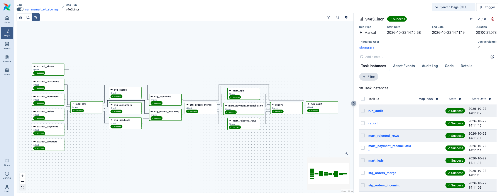
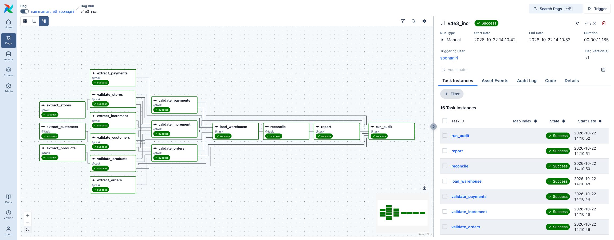
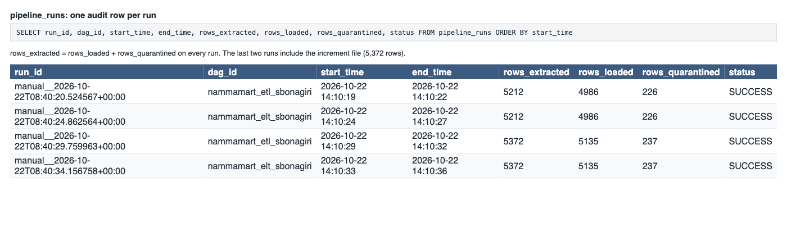

# NammaMart ETL and ELT pipelines: submission

Name: sangarajugupta bonagiri. DAGs: `dags/nammamart_etl_sbonagiri.py`, `dags/nammamart_elt_sbonagiri.py`.

## 0. What is in the repo

| Path | Purpose |
| --- | --- |
| `dags/nammamart_etl_sbonagiri.py` | ETL DAG: 6 parallel extracts, validate and quarantine, transform, load star schema, reconcile, report, run audit |
| `dags/nammamart_elt_sbonagiri.py` | ELT DAG: extract checks, raw load, SQL staging, MERGE for the increment, SQL marts, report, run audit |
| `include/nammamart_common.py` | Paths, DuckDB connection with lock retry, schema contract, PII masking, `dq_results` and `pipeline_runs` writers |
| `include/nammamart_dq.py` | Python quality checks (ETL) |
| `include/nammamart_etl.py`, `include/nammamart_elt.py` | Task bodies for the two DAGs |
| `include/sql/stg_*.sql`, `mart_*.sql` | ELT transformations, one file per table or layer |
| `include/sql/business_questions.sql` | The six business questions, once on the ETL tables and once on the ELT tables |
| `include/nammamart_profile.py` | Part 0 profiling script |
| `include/data_issues_log.csv` | Row-level data issues log: 318 rows with file, row key, source line, column, problem, dimension, severity, proposed rule |
| `include/data/nammamart/` | The six source CSVs, never edited |
| `include/quarantine/sbonagiri/` | ETL quarantine files (`<file>_failed_<run_id>.csv`, with a `failure_reason` column); one sample file is committed |
| `business_questions_results.md` | SQL and results for all six questions, from both pipelines |
| `screenshots/` | Airflow graph views, schedule, `dq_results`, `pipeline_runs`, quarantine file, reconciliation |

Warehouse file: `include/warehouse_sbonagiri.duckdb`. Both DAGs have three params: `load_increment` (default false), `data_dir` (source folder override) and `as_of_date` (overrides "today" for the timeliness checks).

How the pipelines were checked: both DAGs parse and run green on Airflow 3.3.2. For the same input, ETL and ELT give identical net revenue, gross margin and reconciliation records, and all 73 quality checks give the same `rows_checked` and `rows_failed`.

Run order used for the results: one run with the five base files, then a second run with `load_increment=true`. Total rows seen by the second run: 5,372 (the full dataset).

The local warehouse file and the quarantine files that hold unmasked customer rows are in `.gitignore`, so no unmasked personal data is committed outside `include/data/`.

## Headline results

- **The two pipelines agree to the paisa.** After the base run and after the increment, ETL and ELT give the same clean-row counts, net revenue (1,170,322.20 after the increment), gross margin (282,701.79), reconciliation records (394, amount 241,771.95), top customers, and the same `rows_checked` and `rows_failed` for all 73 quality checks.
- **Base run (5 files, 5,212 rows):** 4,986 rows loaded, 226 quarantined: orders 190 of 2,412, payments 21 of 2,228, customers 8 of 405, products 7 of 152, stores 0 of 15.
- **Increment run (5,372 rows):** 160 increment rows read, 149 accepted (139 new orders inserted, 10 corrections applied), 11 quarantined. Re-running the increment inserts and changes nothing.
- **September revenue** is 1,099,593.60 as first loaded and 1,095,399.90 after the 10 returns arrive. The 4,193.70 difference is the "returned later" case in Part E9.
- **Findings for Sameer and Kavya:** (1) 111 orders (105 delivered, 46,819.80) are rejected only because a product or customer they point to is missing or was itself rejected, for example five products with a cost above the price. (2) 155 payments (114,259.83) belong to orders that were rejected, so finance sees money collected that never reaches the reports. (3) 52 delivered or returned orders have a failed or wrong-status payment (29,915.95).
- **Observability found three real bugs in my own build**, all fixed: a failed run showed green, a raw load broke on mixed line endings, and Clear could not re-run ETL tasks because the staging files were deleted (Part F).

## Part 0: Discovery and data profiling

Profiling script: `python include/nammamart_profile.py`. It prints row counts, nulls, duplicate keys, min and max of numeric and date columns, distinct values of category columns, the four referential checks and the business-rule checks.

Summary of what it found:

| File | Rows | Main findings |
| --- | --- | --- |
| orders.csv | 2,412 | 12 duplicated `order_id` (exact copies), 18 null `customer_id`, 10 non-positive `quantity`, 18 wrong `order_amount`, 3 `discount_pct` above 100, 6 `delivery_minutes` of 480 to 1440, 8 DELIVERED without `delivery_minutes`, 5 unparseable and 1 null `order_ts`, 7 timestamps after the file's extract date, 5 unknown `store_id`, 9 unknown `product_id`, status `Pending??` and `delivered`, payment mode `upi`, `UPI `, `CARD`, `cod`, `Cashh` |
| payments.csv | 2,228 | 4 duplicated `payment_id`, 10 payments of zero or less, 5 payments dated after the extract, 8 payments for orders that do not exist, mode `Cashh` and casing variants, 301 empty `gateway_ref` (all cash on delivery) |
| customers.csv | 405 | 5 duplicated `customer_id` with different phone numbers, 3 signup dates in the future, 7 phones that are not 10 digits, 12 bad emails, 3 pincodes like `5600XX`, loyalty tier in 3 different casings, 6 empty cities |
| products.csv | 152 | 2 duplicated `product_id` (the "(old)" rows), 3 empty categories, 1 negative `mrp`, 5 `cost_price` above `mrp` |
| stores.csv | 15 | 1 empty zone (S07), 1 capacity of 0 (S12) |
| orders_2026-10-01_increment.csv | 160 | 150 new orders and 10 corrections to September orders (DELIVERED to RETURNED). Within the file there are no duplicates. 11 rows reference a rejected product or customer. |

### Data Issues Log

The full row-level log is [include/data_issues_log.csv](include/data_issues_log.csv): 318 rows covering all five files and the increment (orders 213, customers 44, payments 37, products 11, increment 11, stores 2), each with the row key, the line number in the source file, the column, the problem, the dimension, the severity and the proposed rule. The grouped version below has one example key per issue.

Severity follows Part D: Critical rows are quarantined, Warning rows load and are logged.

| # | File | Row key (examples) | Column | Problem | Dimension | Proposed rule | Severity |
| --- | --- | --- | --- | --- | --- | --- | --- |
| 1 | orders | ORD001462, ORD001441 (12 rows) | order_id | Exact duplicate of another row | Uniqueness | Keep the first row per `order_id`, quarantine the rest | Critical |
| 2 | orders | ORD002255, ORD000701 (18 rows) | customer_id | Null | Completeness | `customer_id` must be present | Critical |
| 3 | orders | ORD000403 | order_ts | Null (`N/A` in the source) | Completeness | `order_ts` must be present | Critical |
| 4 | orders | ORD001610, ORD000946 (5 rows) | order_ts | `2026-13-05 11:00:00`, `31/09/2026 10:00` do not parse | Validity | Must parse as `YYYY-MM-DD HH:MM:SS` | Critical |
| 5 | orders | ORD001089, ORD001121, ORD002119 (7 rows) | order_ts | Dated 2026-10-21, 2026-11-02, 2027-01-01, later than the file's extract date | Timeliness | No order later than its file's extract date or the run date | Critical |
| 6 | orders | ORD000500, ORD001970 | order_status | `Pending??` | Validity | Status in DELIVERED, CANCELLED, RETURNED after trim and upper-casing | Critical |
| 7 | orders | ORD001066, ORD000153 | order_status | `delivered` in lower case | Validity | Standardise with upper-casing, do not reject | Fixed in transform |
| 8 | orders | ORD001812, ORD001414 | payment_mode | `Cashh` is not a known mode | Validity | Mode in UPI, Card, Cash on Delivery, Wallet | Critical |
| 9 | orders | ORD000159, ORD002356, ORD001640 | payment_mode | `upi`, `UPI `, `cod`, `CARD` | Validity | Map to the four valid values | Fixed in transform |
| 10 | orders | ORD000469, ORD001296 (10 rows) | quantity | Zero or negative | Accuracy | `quantity > 0` | Critical |
| 11 | orders | ORD002103, ORD001468, ORD001237 | discount_pct | 250, 120, 150 | Validity | 0 to 100 | Critical |
| 12 | orders | ORD002103, ORD002305 (18 rows) | order_amount | Does not equal quantity x unit_price x (1 - discount) | Accuracy | Recompute and compare within 0.01 | Critical |
| 13 | orders | ORD001554, ORD001800 (8 rows) | delivery_minutes | DELIVERED but empty | Completeness | DELIVERED needs `delivery_minutes` | Critical |
| 14 | orders | ORD001037, ORD000455 (6 rows) | delivery_minutes | 480, 900, 1440 minutes | Accuracy | Below 120 is Critical, outside 8 to 35 is a Warning | Critical / Warning |
| 15 | orders | ORD001799, ORD001046, ORD002126 (5 rows) | store_id | S99, S17, S00 are not in stores | Consistency | Key must exist in the validated master | Critical |
| 16 | orders | ORD000986, ORD001058 (87 rows in all) | product_id | P9455, P9212 do not exist, or the product was rejected | Consistency | Key must exist in the validated master | Critical |
| 17 | orders | 18 rows | customer_id | Customer was rejected (future signup date) | Consistency | Key must exist in the validated master | Critical |
| 18 | payments | PAY0000509, PAY0001651 (4 rows) | payment_id | Exact duplicate | Uniqueness | Keep the first | Critical |
| 19 | payments | PAY0001568, PAY0002175, PAY0000116 (10 rows) | amount_paid | Negative or zero | Accuracy | `amount_paid > 0` | Critical |
| 20 | payments | PAY0000396, PAY0000127 (5 rows) | payment_ts | After the extract date | Timeliness | No future timestamps | Critical |
| 21 | payments | PAY0000522, PAY0000044 | payment_mode | `Cashh` | Validity | Allowed list | Critical |
| 22 | payments | PAY0002219, PAY0002220 (8 rows) | order_id | Order does not exist | Consistency | Load, show in the reconciliation as `PAYMENT_FOR_UNKNOWN_ORDER` | Warning |
| 23 | payments | 301 rows | gateway_ref | Empty for non-cash payment modes | Completeness | Required unless Cash on Delivery | Warning |
| 24 | customers | C00103, C00252, C00226 (5 rows) | customer_id | Same id with different phone and area | Uniqueness | Keep the first, quarantine the rest | Critical |
| 25 | customers | C00400, C00398, C00038 | signup_date | 2026-11-12, 2026-12-20, 2027-01-05 | Timeliness | No future dates | Critical |
| 26 | customers | C00307, C00063, C00337 (12 rows) | email | Missing `@`, missing top-level domain, empty | Validity | Email pattern | Warning |
| 27 | customers | C00151, C00240 (7 rows) | phone | 7 to 9 digits | Validity | 10 digits | Warning |
| 28 | customers | C00132, C00083, C00166 | pincode | `5600XX` | Validity | 6 digits | Warning |
| 29 | customers | C00199, C00133, C00032 (8 rows) | loyalty_tier | `SILVER`, `BRONZE`, `bronze` | Consistency | One casing, standardise to Title case | Warning |
| 30 | customers | C00355, C00394 (6 rows) | city | Empty | Completeness | Present | Warning |
| 31 | products | P0030, P0140 | product_id | A second row named "(old)" with a different `mrp` | Uniqueness | Keep the first | Critical |
| 32 | products | P0109 | mrp | -203 | Accuracy | `mrp > 0` | Critical |
| 33 | products | P0019, P0073, P0074, P0109, P0117 | cost_price | Above `mrp` | Accuracy | `cost_price <= mrp` | Critical |
| 34 | products | P0051, P0060, P0068 | category | Empty | Completeness | Load with `UNKNOWN`, log a Warning | Warning |
| 35 | stores | S07 | zone | Empty | Completeness | Load with `UNKNOWN`, log a Warning | Warning |
| 36 | stores | S12 | capacity_orders_per_day | 0 | Accuracy | Greater than 0 | Warning |
| 37 | increment | 11 rows | product_id, customer_id | Reference a rejected product or customer | Consistency | Same rules as the base file | Critical |

Why dimension attributes (category, zone) are Warnings and not Critical: dropping the row would also drop every order that uses it. Store S07 alone has 176 orders. They are reported under `UNKNOWN` and flagged until ops fixes the master data.

### Three questions for the client

1. Is a negative `quantity` a return or a data-entry error? Today it is treated as an error and the order is quarantined.
2. Eighty-four delivered orders (34,544.60) are rejected only because their product is unknown or its master row was rejected (for example cost above price). Should those orders still count towards revenue while the product master is fixed?
3. Should a RETURNED order reduce revenue in the month it was delivered (September) or in the month it was returned (October)?

## Part C: Scheduling answers

Both DAGs use `schedule="0 9 * * 1-6"`, `start_date=pendulum.datetime(2026, 9, 1, tz="Asia/Kolkata")`, `catchup=False`, `max_active_runs=1`, and in `default_args`: `retries=2`, `retry_delay=2 minutes`, `execution_timeout=15 minutes`.

- **Cron expression:** `0 9 * * 1-6`, which is 09:00 on Monday to Saturday.
- **Time in UTC:** 03:30 UTC. Airflow showed the scheduled run `scheduled__2026-10-22T03:30:00+00:00` for 22 October.
- **If `start_date` were in UTC:** Airflow would read "9:00" as 09:00 UTC, which is 14:30 IST. The numbers would arrive five and a half hours late, after the 9:30 stand-up, and the SLA would be missed every day.
- **If the laptop or Docker is off at 9:00:** nothing runs at 9:00. With `catchup=False`, the older missed days are skipped. When Airflow comes back it starts one run for the latest missed 9:00 slot. That is what happened on my machine: Airflow was started in the afternoon and immediately ran the 22 October 9:00 slot. The report would then be late, so a production setup needs an always-on host.
- **Why `catchup=False`:** each run rebuilds the reports from the full files, so replaying 20 missed days would repeat the same work and add no new information. Late changes are handled by the increment file, not by backfills.
- **Why these retry settings:** a failed extract is often a late file, so two retries two minutes apart cover short delays. The 15-minute timeout stops a hung task from blocking the 9:30 review. Schema changes fail at once without retries, because a changed header will not fix itself.

## Part D: Data quality dimensions

Every check, on every run, writes a row to `dq_results` (`run_id`, `dag_id`, `check_name`, `dimension`, `severity`, `rows_checked`, `rows_failed`, `status`, `checked_at`). There are 73 checks per run with the increment (53 without it), implemented in Python for ETL (`include/nammamart_dq.py`) and in SQL for ELT (`include/sql/stg_*.sql`).

| Dimension | Checks | Severity |
| --- | --- | --- |
| Completeness | `order_id`, `customer_id`, `order_ts` present; DELIVERED has `delivery_minutes`; `payment_id`, `order_id` present in payments; `customer_id`, `product_id`, `store_id` present; city, category, zone present; gateway_ref present for non-cash payments; volume against the previous run | Critical, except city, category, zone, gateway_ref and volume (Warning) |
| Uniqueness | `order_id`, `payment_id`, `customer_id`, `product_id`, `store_id` unique | Critical |
| Validity | status, payment mode and payment status in the allowed lists; discount 0 to 100; timestamps and dates parse; email, phone and pincode formats; channel is App or Web; zone in the allowed list | Critical (status, mode, timestamps, discount), Warning (email, phone, pincode, channel, zone) |
| Accuracy | `quantity > 0`; `unit_price > 0`; amount matches the formula; `delivery_minutes` below 120; `mrp > 0`; `cost_price > 0` and `<= mrp`; `amount_paid > 0`; delivery outside 8 to 35; store capacity above 0 | Critical, except the last two (Warning) |
| Consistency | customer, product and store exist in their validated masters; payment's order exists; loyalty tier casing | Critical (keys), Warning (payment's order, casing) |
| Timeliness | No future `order_ts`, `signup_date` or `payment_ts`; the newest order is at most 1 day old at run time | Critical (future), Warning (stale) |

Checks per dimension, identical in ETL and ELT (73 per run with the increment):

| Dimension | Accuracy | Completeness | Consistency | Timeliness | Uniqueness | Validity | Total |
| --- | --- | --- | --- | --- | --- | --- | --- |
| Checks | 15 | 18 | 8 | 7 | 6 | 19 | 73 |

Two design choices worth knowing:

- An order is "future" if it is later than the extract date of its file (30 September for `orders.csv`, 1 October for the increment) or later than the run date, whichever is earlier. Without this, the two orders dated 2026-10-21 would pass when the pipeline runs on 22 October.
- The freshness check warns on every run of this dataset, because the data is from September. That is expected and is the check working.

## Part E: Data governance

**1. Ownership.** Orders and payments: the head of operations (COO's team) for orders, finance for payments. Customers: the CRM owner (marketing). Products: the category or catalogue manager. Stores: the store operations lead. The warehouse tables and DAGs: the data engineering owner (the FDE team now, a named NammaMart engineer later). A change to a quality rule, such as the 120-minute delivery limit, is proposed by the data owner of the file, approved by the COO (the business owner of the KPI) and finance if revenue changes, and made as a reviewed commit to `nammamart_dq.py` and the matching SQL file.

**2. Data dictionary.**

`etl_fact_orders` (one row per accepted order; the ELT equivalent is `stg_orders` filtered to `dq_status <> 'FAILED'`)

| Column | Type | Meaning | Source | Allowed values | PII |
| --- | --- | --- | --- | --- | --- |
| order_id | VARCHAR | Order key | orders.csv | ORD + 6 digits | No |
| order_ts | TIMESTAMP | When the order was placed (IST) | orders.csv | Not in the future | No |
| order_date | DATE | Date part of `order_ts` | derived | | No |
| customer_id | VARCHAR | Customer key | orders.csv | Exists in `etl_dim_customer` | Indirect |
| store_id | VARCHAR | Store key | orders.csv | Exists in `etl_dim_store` | No |
| product_id | VARCHAR | Product key | orders.csv | Exists in `etl_dim_product` | No |
| quantity | BIGINT | Units | orders.csv | Greater than 0 | No |
| unit_price | DOUBLE | Price per unit | orders.csv | Greater than 0 | No |
| discount_pct | DOUBLE | Discount | orders.csv | 0 to 100 | No |
| order_amount | DOUBLE | quantity x unit_price x (1 - discount) | orders.csv | Matches formula | No |
| payment_mode | VARCHAR | How the customer pays | orders.csv, standardised | UPI, Card, Cash on Delivery, Wallet | No |
| order_status | VARCHAR | Order outcome | orders.csv, upper-cased | DELIVERED, CANCELLED, RETURNED | No |
| channel | VARCHAR | App or Web | orders.csv | App, Web | No |
| delivery_minutes | DOUBLE | Minutes to deliver | orders.csv | Below 120 | No |
| net_revenue | DOUBLE | `order_amount` if DELIVERED, else 0 | derived | | No |
| gross_margin | DOUBLE | `order_amount - quantity x cost_price` if DELIVERED, else 0 | derived | | No |
| within_15_min | BOOLEAN | Delivered in 15 minutes or less (NULL if not delivered) | derived | | No |
| source_batch | VARCHAR | Extract date of the file the row came from | derived | 2026-09-30, 2026-10-01 | No |
| loaded_run_id | VARCHAR | Airflow run that wrote the row | derived | | No |

`etl_dim_customer`

| Column | Type | Meaning | Source | Allowed values | PII |
| --- | --- | --- | --- | --- | --- |
| customer_id | VARCHAR | Key | customers.csv | Unique | Indirect |
| full_name | VARCHAR | Customer name | customers.csv | | Yes |
| email_masked | VARCHAR | `pr***@example.com` | masked from `email` | | Masked |
| phone_masked | VARCHAR | `97******21` | masked from `phone` | | Masked |
| city, area, pincode | VARCHAR | Location | customers.csv | Pincode: 6 digits | Yes (location) |
| signup_date | DATE | When the customer joined | customers.csv | Not in the future | No |
| loyalty_tier | VARCHAR | Tier, Title case | customers.csv, standardised | Bronze, Silver, Gold, Platinum | No |
| is_active | VARCHAR | Active flag | customers.csv | Y, N | No |

`etl_dim_product`: `product_id`, `product_name`, `category` (`UNKNOWN` when empty), `sub_category`, `brand`, `mrp` (above 0), `cost_price` (above 0, at most `mrp`), `unit`, `is_perishable`. No PII.

`etl_dim_store`: `store_id`, `store_name`, `zone` (North, South, East, West, or `UNKNOWN`), `area`, `pincode`, `manager_name` (the manager's name is personal data about an employee), `capacity_orders_per_day`.

**3. Lineage.** Take 1 September, store S01, in `mart_daily_store_kpis`: net revenue 1,410.80 on 3 delivered orders. In ELT one query traces it: `SELECT order_id, order_amount, _source_file, _row_id + 1 AS file_line, _run_id FROM stg_orders WHERE store_id = 'S01' AND order_date = '2026-09-01' AND order_status = 'DELIVERED' AND dq_status <> 'FAILED'` returns ORD000013 (28.80, line 1369 of `orders.csv`), ORD000025 (788.00, line 728) and ORD000058 (594.00, line 444). 28.80 + 788.00 + 594.00 = 1,410.80. The same keys point at the untouched text row in `raw_orders`. In ETL the fact row has `source_batch` and `loaded_run_id`, so I can reach the same three `order_id`s and the run, but the cleaned row no longer keeps its line number and the clean staging files are deleted after seven days. I would have to search the CSV by `order_id`. ELT is easier because every layer carries `_source_file`, `_row_id` and `_run_id` and the raw copy stays in the same database.

**4. Personal data.** Columns that are personal data: `full_name`, `email`, `phone`, `city`, `area` and `pincode` of customers (location together with a name), and `manager_name` in stores. `customer_id` is a pseudonym that is personal data when linked to the rest. Masking: email keeps the first two characters and the domain (`pr***@example.com`), phone keeps the first and last two digits (`97******21`), done in Python for ETL and in SQL for ELT. Masking rather than deleting keeps the reports useful: analysts can still tell that a customer has a valid email and phone, count duplicates, and support can identify a customer by the last digits, without seeing the full values. The law is India's Digital Personal Data Protection Act, 2023. It expects a lawful purpose and consent or another legal basis, use only for that purpose, reasonable security safeguards, deletion when the purpose ends, a way for people to see and correct their data, and breach notification. `raw_customers` and the CSV files in `include/data/` still hold unmasked data, so they need the access limits below.

**5. Access control.**

| Layer | Who can read |
| --- | --- |
| Raw tables, source CSVs | Data engineers only, and compliance on request. Raw `customers` holds full phone numbers and emails, so nobody else needs it. If a real need exists (for example a customer-support call), it is a logged, case-by-case request approved by the data owner. |
| Staging tables | Data engineers and analysts approved for data work. Staging holds only masked contact details. |
| Mart and fact tables | Store managers, finance, COO: masked data only. |
| Quarantine files and `etl_quarantine` | Data engineers and the data owners fixing the source. The files hold rejected rows as received, including unmasked customer rows, so treat them like raw. |

**6. Retention.** Raw data: keep 7 years for finance audit (to be confirmed with finance and the auditor), but move unmasked customer columns out of the raw layer after 90 days, keeping only masked values. Quarantine files: 90 days, or until the source system has fixed the row, then delete. Masked customer data: for as long as the customer is active plus one year, then delete or anonymise. `dq_results` and `pipeline_runs` are small and useful for trends: keep for 2 years. After the retention period the data is deleted, and the deletion is logged.

**7. Secrets.** In this setup there are no credentials in the DAG files. Anything secret (for example `SLACK_WEBHOOK_URL`) belongs in an Airflow Variable or Connection, read with `Variable.get()`, and stored in the Airflow metadata database (or a secrets backend), and in `.env` or `airflow_settings.yaml` locally, both of which are in `.gitignore`. A secret in the DAG file would be in Git history for anyone with repo access forever, and anyone who can read the repo (including a public fork or pull request) could post to the Slack channel or use the key.

**8. Audit.** Take the rejected order `ORD002103`.
- **As received:** `raw_orders` (ELT) holds `ORD002103,2026-09-27 09:31:35,C00025,S03,P0093,1,492.0,250,492.0,UPI,DELIVERED,App,23` untouched, line 66 of `orders.csv`. The ETL quarantine file holds the same row with a `failure_reason` column, and `SELECT * FROM etl_quarantine WHERE row_key = 'ORD002103'` shows it in SQL.
- **Rule it broke:** `discount_pct outside 0-100` (the discount is 250) and `order_amount does not match quantity x unit_price x (1 - discount)`. In ELT, `SELECT order_id, dq_status, failure_reason FROM stg_orders WHERE order_id = 'ORD002103'` returns `FAILED` and both reasons, and `mart_rejected_rows` lists it.
- **Not in the CFO's total:** `SELECT COUNT(*) FROM etl_fact_orders WHERE order_id = 'ORD002103'` returns 0, and `SELECT COUNT(*) FROM stg_orders WHERE order_id = 'ORD002103' AND dq_status <> 'FAILED'` returns 0. The marts are built only from rows that did not fail, so it adds nothing to revenue.

ELT answers all three parts from one database. ETL needs the quarantine file for the first part and the warehouse for the other two.

**9. Change history.** After the increment, both pipelines overwrite the old row: an order delivered on 3 September and returned on 1 October shows as RETURNED, so its `net_revenue` becomes 0 and September revenue falls. For the 10 corrected orders in this dataset (for example `ORD000017`, 16.00, delivered on 1 September), September revenue falls from 1,099,593.60 to 1,095,399.90, a drop of 4,193.70. Finance would want both: the as-reported September number (what was true on 30 September, which matches what was already shown to the CFO) and the restated number (what is true now). To keep both views, I would keep an append-only history: in ELT every run already adds rows to `raw_orders`, so the old status is still there and a `stg_orders_history` table (or an SCD Type 2 table with `valid_from` and `valid_to`) can be built from it with SQL. In ETL I would add a history table written before the upsert. Revenue then gets reported "as of" a date.

## Part F: Observability tests

The experiments ran on a real Airflow 3.3.2 scheduler (standalone, LocalExecutor, SQLite metadata database), not through `dags test`, using the REST API and the task states Airflow stores. Both DAGs shared one warehouse file. To leave the original files untouched, each experiment pointed the DAG at a modified copy of the data through the `data_dir` param, and `as_of_date=2026-10-01` was used so the "today" of the timeliness checks sits the day after the data. The log of the first full sequence is in [docs/experiments/airflow_experiment_log.txt](docs/experiments/airflow_experiment_log.txt). Experiments 4, 5, 8 and 10 were repeated after the fixes described below; their final numbers are in the table.

Each audit row is `rows_extracted / rows_loaded / rows_quarantined`.

| # | Experiment | Expected | Observed | Where I saw it | What I would change |
| --- | --- | --- | --- | --- | --- |
| 1 | Happy path | Both DAGs green, extracts in parallel | ETL run 11.3 s, ELT run 19.0 s. All 6 extracts started within the same second in both DAGs. ETL then ran `validate_customers`, `validate_products`, `validate_stores` and `validate_payments` together, and `validate_orders` waited for the three dimensions. ELT ran `stg_customers`, `stg_products`, `stg_stores` and `stg_payments` together, and `stg_orders_incoming` waited for the three dimensions. Rows in / passed / quarantined (ETL): orders 2,412 / 2,222 / 190, payments 2,228 / 2,205 / 23, customers 405 / 397 / 8, products 152 / 145 / 7, stores 15 / 15 / 0. Audit row: 5,212 / 4,984 / 228 in both DAGs. | Grid and Graph view, task start and end times, `[Validate]` log lines, `pipeline_runs` | Nothing for the parallelism. The ELT dimension tasks wait for each other's DuckDB lock, which is why ELT is slower. |
| 2 | Re-run the same DAG | Fact counts unchanged. Raw tables grow in ELT, which is correct. | `etl_fact_orders` 2,222 to 2,222 and revenue 1,099,593.60 both times. `stg_orders` 2,400 to 2,400 and mart revenue 1,099,593.60 both times. `raw_orders` grew from 2,412 to 4,824 rows, and the other raw tables doubled too. Raw is append-only on purpose: every run keeps its own copy with `_run_id`. | Row counts after each run, `raw_*` table sizes | Raw grows without limit. Add a retention rule (Part E6), and load only changed files. |
| 3 | Incremental file | 150 new orders appended, 10 corrected orders updated, no duplicates | ETL: 160 rows read, 149 accepted: 139 inserted and 10 status changes, 11 quarantined. Fact grew from 2,222 to 2,361 orders, with 2,361 distinct `order_id`s. ELT MERGE: 150 inserted (11 of them stored as `FAILED`) and 10 status changes. `stg_orders` grew from 2,400 to 2,550 with 2,550 distinct `order_id`s. Re-running the increment: 0 inserted, 0 changed in both. Re-running the old base file afterwards left the 10 corrected statuses alone (10 rows kept as newer). The last two checks were run by calling the task functions directly, outside Airflow. | `[Load]` and `[Merge]` log lines, `etl_fact_orders`, `stg_orders` | Alert when a correction itself is rejected, because the old value then stays silently. |
| 4 | Rename `products.csv` | Retries, then fail. Nothing loads. | `extract_products` failed on try 1 after about 2 s, on try 2 about 2 minutes later and on try 3 about 4 minutes after the start, which matches `retry_delay=2 minutes` and `retries=2`. Final state `failed`. `validate_products`, `validate_orders`, `validate_increment`, `load_warehouse`, `reconcile` and `report` (ETL) and `load_raw` and every task after it (ELT) ended `upstream_failed`. The other extracts and the independent validators finished. No load task ran, so the warehouse was untouched. `run_audit` ran anyway and wrote a `FAILED` row. **Bug found:** the DAG run itself showed green, because `run_audit` (`trigger_rule="all_done"`) is the only last task and it succeeded. | Grid colours, task attempt logs, `pipeline_runs` | Fixed: `run_audit` now writes its row and then raises, so a failed run is red. Confirmed in experiments 5 and 6. There is still no push alert: add an `on_failure_callback` that posts to a Slack webhook read from an Airflow Variable. |
| 5 | 5 bad rows appended | Each quarantined with the right reason | All five rejected in both pipelines, none in the fact table or the marts: `ORD009001` customer_id missing, `ORD009002` quantity not positive, `ORD009003` store_id not in validated stores, `ORD009004` order_status not in allowed list, `ORD009005` order_ts in the future. `dq_results` moved by exactly +1 on `customer_id_present` (18 to 19), `quantity_positive` (10 to 11), `store_exists` (5 to 6), `order_status_allowed` (3 to 4) and `order_ts_not_future` (7 to 8). Audit row 5,217 / 4,984 / 233 in both (5 more rejected than experiment 1). **Bug found:** my first ELT attempt failed at `load_raw`, because I appended rows with a different line ending to the file and DuckDB's CSV sniffer rejected the mixed endings. The ETL (pandas) did not notice. | `etl_quarantine`, `mart_rejected_rows`, `dq_results`, task log of `load_raw` | Fixed: the raw load now uses a fixed CSV dialect and `strict_mode=false`, since the raw layer should accept what arrives. Alert on a jump in rejects, not only on counts. |
| 6 | Rename `order_amount` to `total` | Loud failure | `extract_orders` failed on try 1 with no retries: `Schema change in orders.csv: missing columns ['order_amount'], unexpected columns ['total']`. Nothing was loaded in either pipeline (fact revenue stayed 1,170,322.20), the audit row says `FAILED` and the run is red. | Task log of `extract_orders`, Grid view, `pipeline_runs` | Schema failures use `AirflowFailException`, so there is no pointless retry. Compare column types as well as names. |
| 7 | Only 50 orders | A warning if volume drops by more than 90% | I added `orders.volume_vs_previous_run` as a check. It reported `WARN` (50 rows against 2,412 the run before) in both pipelines, and the run still finished `success` (audit 2,850 / 2,810 / 40). The 50 rows did not replace the 2,361 orders already in the fact table, because loads are upserts. | `dq_results`, `pipeline_runs` | Make this a blocking Critical gate with a manual override. A warning alone does not stop a half-empty file from becoming "today's report". |
| 8 | Unit price x 100 for store S05 | A check catches it | (A) Only `unit_price` changed: `order_amount_formula` caught it, 162 failures against 18 in the baseline, so 144 more orders failed the check and 134 more rows were quarantined in total (audit quarantined 362 against 228, because some rows already failed another rule). The fact and the marts kept the earlier accepted S05 numbers, 82,456.15. (B) `unit_price` and `order_amount` both x 100 (run on a fresh warehouse, base file only): **no check fired.** Rejected rows stayed at 228. Total revenue went from 1,099,593.60 to 8,562,307.65, and S05 from 75,380.95 to 7,538,095.00. | `dq_results`, `mart_daily_store_kpis` | Add a distribution check, for example revenue per store per day against its trailing average, or `unit_price` against the product `mrp`, as a blocking gate. |
| 9 | Latest order 30 days old | Timeliness warns | With `as_of_date` 2026-10-01 the freshness check passed (newest order 2026-09-30). With `as_of_date` 2026-10-30 it reported `WARN` in both pipelines. On the real run date of 22 October it also warns, as the data is from September. **Bug found while building the results:** the first version looked only at the run date, so the order dated 2026-10-21 made the data look fresh. It now ignores rows that fail the future-date rule. | `dq_results` row `orders.latest_order_within_1_day` | Add the same check for `payments`. |
| 10 | Recovery after a failure | Clear re-runs only the failed task and its downstream | After restoring `products.csv` and clearing `extract_products` with its downstream tasks, ELT re-ran `extract_products` (try 4), `load_raw`, all staging and mart tasks, `report` and `run_audit`, and the 5 other extracts kept their first success. ETL re-ran 8 tasks (`extract_products`, `validate_products`, `validate_orders`, `validate_increment`, `load_warehouse`, `reconcile`, `report`, `run_audit`) and the other 8 kept their first success. Both runs ended green. **Bug found:** at first the ETL could not recover, because `run_audit` deleted the staging files of the run and `validate_orders` then could not find the customer and product outputs. | Grid view (try numbers), task start times | Fixed: staging folders are now kept for 7 days and only older ones are deleted. |

### Five pillars of data observability

| Pillar | What covers it in my pipelines | Strongest or weakest |
| --- | --- | --- |
| Freshness | `orders.latest_order_within_1_day` (Warning) and the start and end time of every run in `pipeline_runs` | Partial. No payments freshness check, and nothing alerts if the DAG never starts. |
| Volume | `orders.volume_vs_previous_run` and the row counts in `pipeline_runs` | Partial. It warns but does not block (experiment 7). |
| Schema | Column names and order are checked against a contract in the extract task, which fails at once and loudly (experiment 6) | **Strongest.** |
| Distribution | Only range and rule checks (quantity above 0, discount 0 to 100, delivery below 120) | **Weakest.** A consistent 100 times error passed every check (experiment 8B). |
| Lineage | ELT: `_source_file`, `_row_id`, `_run_id` through raw, staging and mart. ETL: `source_batch`, `loaded_run_id` and the quarantine rows. | Good in ELT, weaker in ETL (Part E3). |

## Part G: Recommendation to Sameer (CTO)

**Adopt ELT. Land every raw file untouched, clean and gate it in SQL, and let finance read only the marts.**

I built both on the same five files and ran them side by side. They gave the same answers: net revenue 1,170,322.20, gross margin 282,701.79, 394 reconciliation records and the same result on all 73 quality checks. So the choice is not about correctness. It is about what happens when something goes wrong, and there ELT was better.

- **Auditability.** Finance asked: "show a rejected order exactly as received, the rule it broke, and prove it is not in the revenue." ELT answered it from one database (`raw_orders`, `stg_orders`, the mart), with the source line and run id on every layer. ETL had to go to a quarantine file for the first part. Raw also lets us replay history, for example when the 10 September orders came back as returns.
- **Data quality guarantees.** Equal in practice, different by design. In ETL a bad row never enters the warehouse. In ELT it sits in staging marked `FAILED` and the marts leave it out, so the guarantee rests on one filter. I tested that filter with five injected bad rows (experiment 5): none reached the marts. ETL's guarantee is stronger by construction. I accept the trade because the marts are the only tables finance can read.
- **Ease of change.** In ELT a rule such as the 120-minute delivery limit is one line in one SQL file, and re-running staging re-judges every raw row. In ETL the file has to be read again, which fails once the export has been replaced. After the fix in experiment 5 the raw layer accepts whatever arrives, so a bad row shows up as a rejected row, while a schema change stops both pipelines at the extract step (experiment 6).
- **Performance at 1000 times the data.** Today a run is 11.3 s for ETL and 19.0 s for ELT on about 5,000 rows, so speed does not decide anything. At 1000 times the data (about 2.4 million orders a month) the ETL reads every file into pandas memory in one process, while ELT lets the database engine do the work. Both write through one DuckDB writer, so the two DAGs queue behind each other (probably why ELT is slower here). At that size I would move to a server warehouse such as Postgres or BigQuery. The SQL files would move with small changes, and the staging step would become incremental.
- **Cost.** Everything is open source, so licences cost nothing. ELT keeps every run: after nine runs `raw_orders` held 12,270 rows for a 2,412-row file. That is cheap storage today but needs a retention rule.

**Top 3 risks of this design**

1. **Unmasked personal data in the raw layer.** `raw_customers` holds full emails and phone numbers, which is the one place the masking does not reach. Limit it to the data team, mask on landing or drop the columns we do not need, and delete raw customer data after 90 days (Part E5 and E6).
2. **Quality rules that hold back real revenue, and errors that pass every rule.** 111 orders (46,819.80 delivered) are rejected only because a master row is missing or invalid, and a consistent 100 times price error passed every check (experiment 8B). Give the master-data owners a daily "fix this" list, and add distribution checks as a blocking gate.
3. **One host, one writer, no push alert.** If the laptop or container is off at 9:00 there is no report (Part C), one DuckDB writer serialises the two DAGs, and nothing messages anyone when a run fails. Run it on an always-on host, add a failure callback that posts to Slack with a webhook kept in an Airflow Variable, and alert when a DAG does not start by 9:05.

## Screenshots

All captured from the Airflow 3.3.2 UI and the warehouse of the runs described above. Re-take them in your own Astro setup if your trainer asks for that environment.

**1. Both DAGs scheduled at 09:00 IST, Monday to Saturday (`0 9 * * 1-6`), next run 2026-10-23 09:00 (+05:30)**

**2. ELT DAG, Graph view, green run (increment loaded)**

**3. ETL DAG, Graph view, green run (increment loaded)**

**4. `dq_results`: checks per dimension and the failing checks of the latest ETL run**

**5. Quarantine file with `failure_reason`, and rejected rows by file and reason**

**6. Payment reconciliation, ETL and ELT**

**7. `pipeline_runs`: one audit row per run**

## Business questions

SQL: [include/sql/business_questions.sql](include/sql/business_questions.sql). Full SQL and results from both pipelines, for all six questions: [business_questions_results.md](business_questions_results.md). Both pipelines return identical results. After the base run and the increment:

| # | Question | Answer |
| --- | --- | --- |
| 1 | Daily net revenue by zone and store (delivered, after discount) | 460 store-day rows. Total by zone: East 301,697.70, West 301,478.90, South 249,010.50, North 236,222.20, UNKNOWN (store S07, empty zone) 81,912.90. Total 1,170,322.20. |
| 2 | Revenue and gross margin by category | Staples 264,456.90 revenue, 66,435.28 margin (25.12%); Household 210,229.95 (25.71%); Personal Care 208,774.70 (22.37%); Dairy & Bakery 177,404.85 (26.61%); Snacks & Beverages 174,575.60 (23.68%); Fruits & Vegetables 92,968.45 (23.68%); UNKNOWN (3 products without a category) 41,911.75 (11.79%). |
| 3 | Average delivery time per store, % within 15 minutes | Average 20.50 to 22.33 minutes. Share within 15 minutes ranges from 21.92% (S15) to 35.67% (S08). No store is close to the "10-minute promise". |
| 4 | Revenue by payment mode, and the amount that does not reconcile | UPI 620,350.55, Card 237,148.25, Cash on Delivery 176,240.70, Wallet 136,582.70. Unreconciled: 394 records, 241,771.95 (no payment found 168 / 92,455.60; payment for a rejected order 155 / 114,259.83; payment status mismatch 52 / 29,915.95; payment for an unknown order 8 / 4,580.57; amount mismatch 11 / 560.00). |
| 5 | Top 10 customers by spend, masked | C00136 Sanjay Bhat (Bronze) 8,738.10, C00283 Nikhil Rao (Bronze) 7,934.60, C00236 Sneha Naidu (Platinum) 7,831.80, then seven more down to C00209 Kavya Pillai (Platinum) 6,519.40. Only `sa***@example.com`-style emails are shown. |
| 6 | Rows rejected in the latest run, by file and reason | Increment run: orders 190 plus 11 from the increment file, payments 21, customers 8, products 7, stores 0. The largest reasons are `product_id not in validated products` (87 orders), `customer_id not in validated customers` (18), `customer_id missing` (18) and `order_amount does not match ...` (18). |
