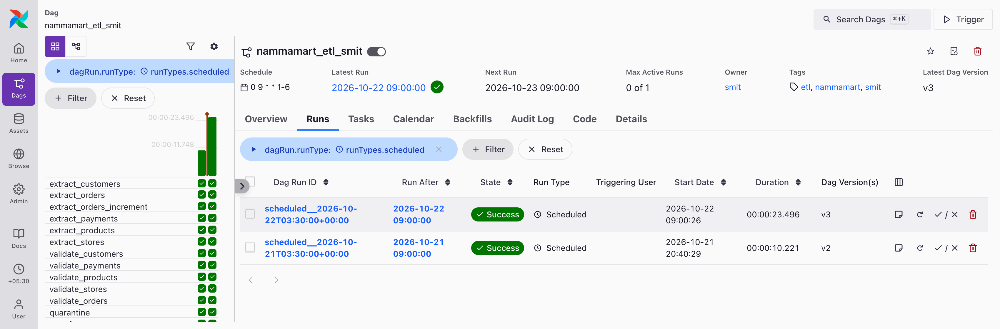
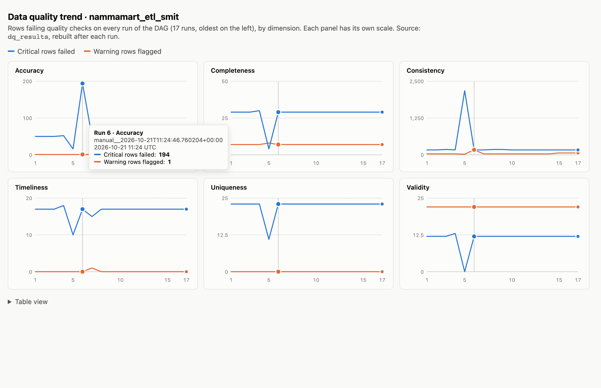
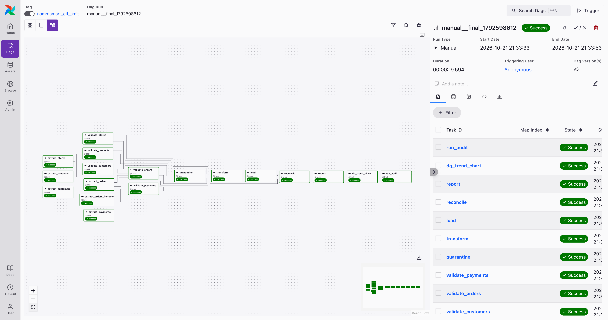
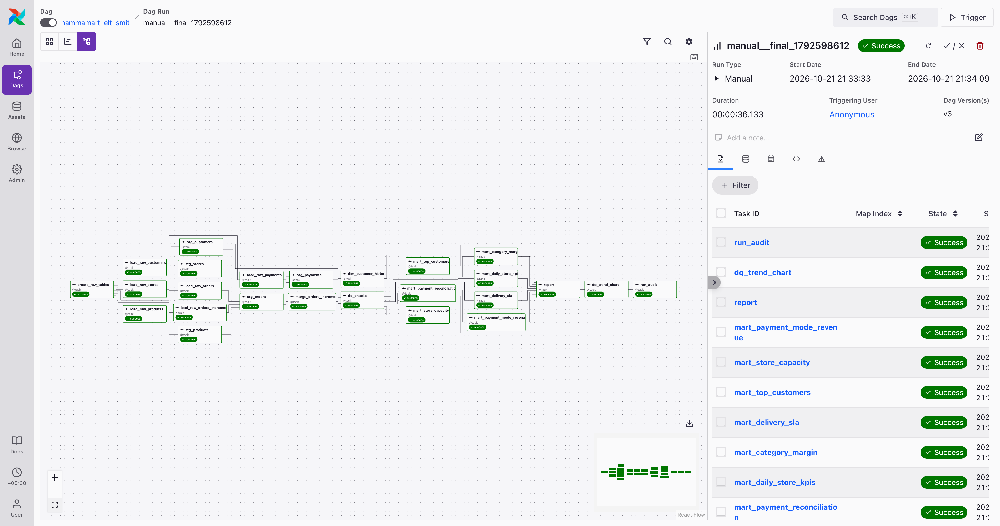
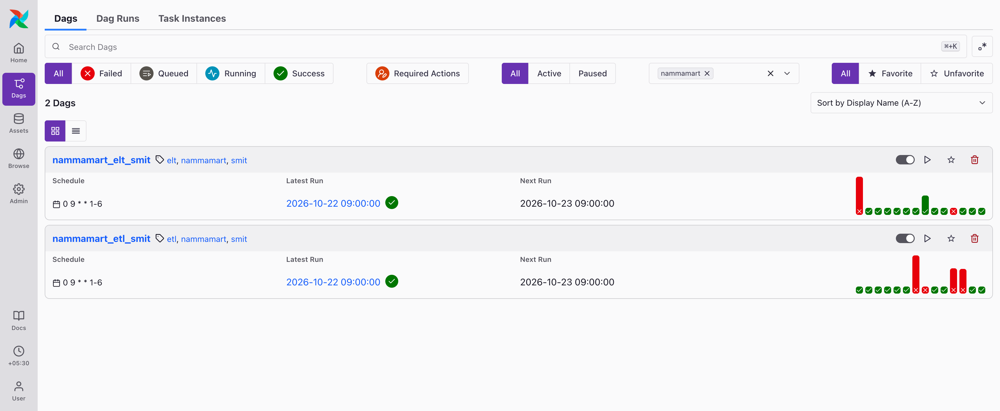
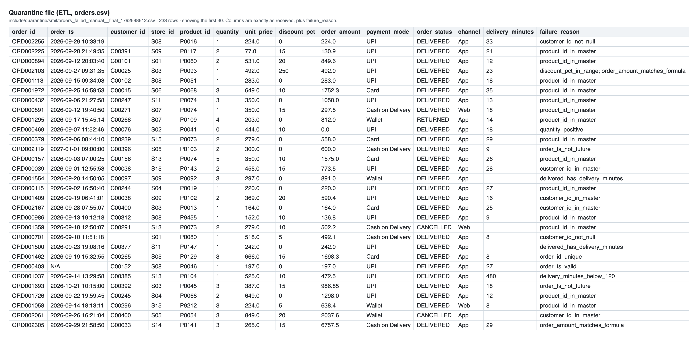
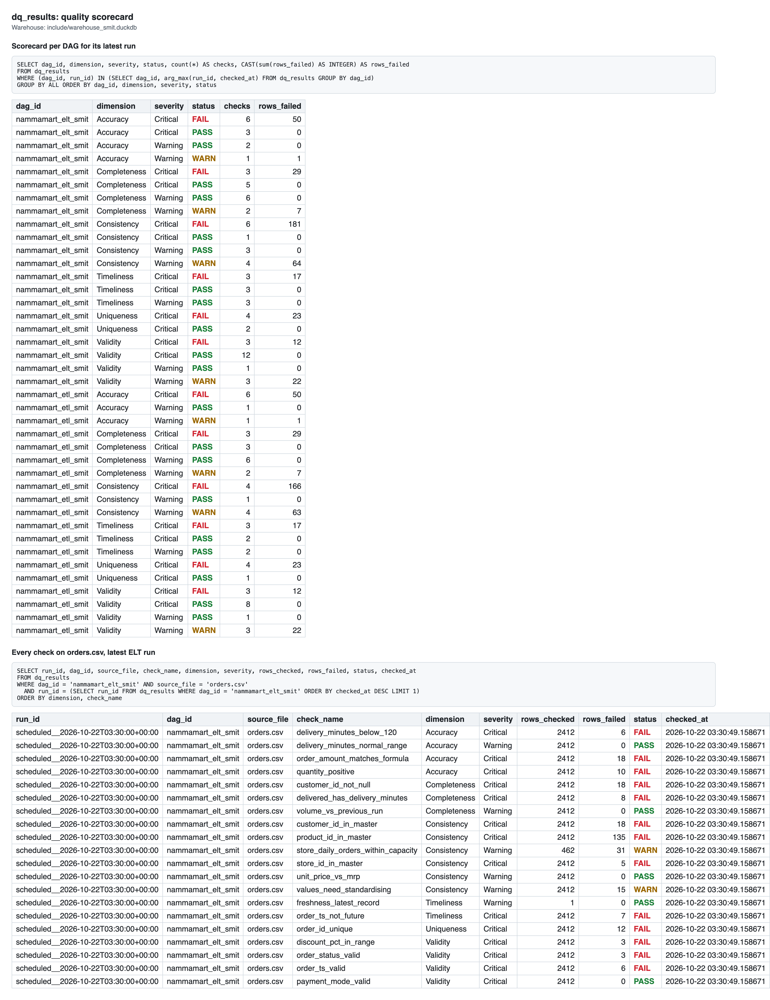
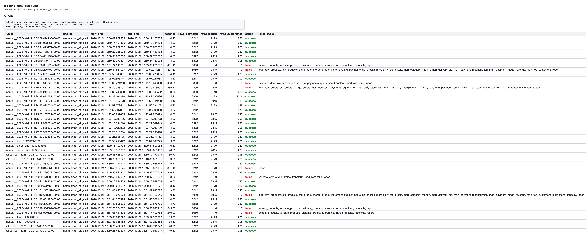
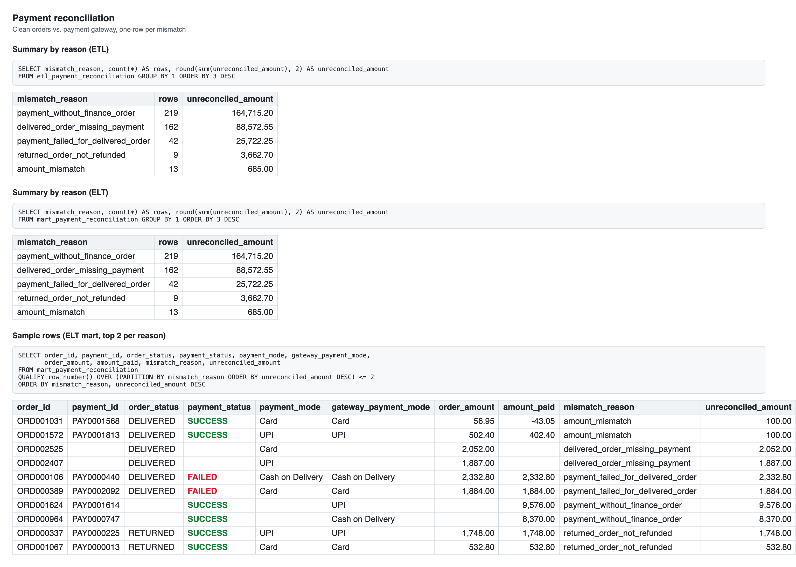

# NammaMart ETL & ELT Pipelines: Submission

**Smit** · FDAIE Module 2, Data Engineering Foundations

## Summary

I built both pipelines on the same six files and ran them side by side. After loading the September files and the 1 October increment, they agree exactly: September net revenue of **₹10,56,885.25** from the same 2,315 clean orders, the same 295 rejected rows and the same 445 order/payment mismatches.

Both DAGs run the same 50 row-level quality checks under the same names, so their rows in `dq_results` line up one to one. Both write to the same `dq_results` and `pipeline_runs` tables. I also did all four bonus items (Slack alert, SCD Type 2 customers, store-capacity check, quality trend chart). They're described in the [Bonus](#bonus) section.

| What | Where |
|---|---|
| ETL DAG (pandas, bad rows quarantined before the warehouse) | [`dags/nammamart_etl_smit.py`](dags/nammamart_etl_smit.py) |
| ELT DAG (raw, staging and mart layers, SQL only) | [`dags/nammamart_elt_smit.py`](dags/nammamart_elt_smit.py) |
| Business rules, paths, file contracts | [`include/nammamart_smit/config.py`](include/nammamart_smit/config.py) |
| Quality checks in pandas (ETL) | [`include/nammamart_smit/quality.py`](include/nammamart_smit/quality.py) |
| PII masking | [`include/nammamart_smit/masking.py`](include/nammamart_smit/masking.py) |
| Profiling script (Part 0) | [`include/nammamart_smit/profile_data.py`](include/nammamart_smit/profile_data.py) |
| DuckDB helpers, `dq_results`, `pipeline_runs` | [`include/nammamart_smit/warehouse.py`](include/nammamart_smit/warehouse.py) |
| File reading, schema contract, increment picker | [`include/nammamart_smit/files.py`](include/nammamart_smit/files.py) |
| Quality trend chart (bonus) | [`include/nammamart_smit/dq_trend.py`](include/nammamart_smit/dq_trend.py) |
| All ELT SQL: raw DDL, staging, the MERGE, marts, quality scorecard, SCD2 | [`include/sql/`](include/sql/) |
| Warehouse | `include/warehouse_smit.duckdb` (not in Git: the raw layer has unmasked customer data) |
| Quarantine files | `include/quarantine/smit/<file>_failed_<run_id>.csv` (created on every run, not in Git) |

### How to run it

```bash
astro dev start
astro dev run dags list-import-errors
astro dev run dags test nammamart_etl_smit
astro dev run dags test nammamart_elt_smit
astro dev run dags test nammamart_elt_smit -c '{"increment_file": "orders_2026-10-01_increment.csv"}'
```

The last command loads the next-day file. In the UI, use Trigger with config and set `increment_file`. A scheduled 9 AM run doesn't need that: it loads every increment file it hasn't loaded yet.

---

## Part 0: Discovery and data profiling

I profiled all six files before writing any pipeline code. The script is [`profile_data.py`](include/nammamart_smit/profile_data.py) and its full output (blanks, distinct values, min/max and value counts for every column) is in [Appendix A](#appendix-a-full-data-profile). I also checked all four relationships and every business rule, including recomputing `order_amount` for every order. The referential integrity problems are issues #13, #14 and #18 below, and the business rule failures are #5 to #12 and #19 to #22.

| File | Rows | Distinct keys | What I found |
|---|---|---|---|
| orders.csv | 2,412 | 2,400 | 12 exact duplicate rows, 18 blank customers, 6 unparseable and 7 future timestamps, 10 zero or negative quantities, 3 discounts over 100 %, 18 amounts that don't match the formula, 6 deliveries of 8 to 24 hours, 8 DELIVERED orders with no delivery time, 5 unknown stores and 9 unknown products, plus odd spellings of status and payment mode |
| payments.csv | 2,228 | 2,224 | 4 exact duplicates, 8 payments for orders that don't exist, 6 negative and 4 zero SUCCESS amounts, 7 future timestamps, 14 SUCCESS payments that don't equal the order amount, odd payment mode spellings |
| customers.csv | 405 | 400 | 5 customer_ids appear twice with a different phone or area, 12 bad emails, 7 short phone numbers, 3 bad pincodes, 6 blank cities, 3 future signup dates, 8 loyalty tiers in the wrong case |
| products.csv | 152 | 150 | 2 product_ids appear twice (an "(old)" row with last season's price), 3 blank categories, 1 negative MRP, 4 cost prices above MRP |
| stores.csv | 15 | 15 | S07 has no zone, S12 has a capacity of 0 |
| orders_2026-10-01_increment.csv | 160 | 160 | 150 new orders and 10 corrections (DELIVERED to RETURNED). Fine on its own, but 13 new orders are on broken products, ORD002486 belongs to a customer with a future signup date, and the correction for ORD000822 is on a broken product |

Some ranges that stood out: `order_amount` goes from −1,593 to 9,576, `delivery_minutes` up to 1,440, `discount_pct` up to 250, `payment_ts` and `signup_date` reach into 2027, and one MRP is −203. All the CSVs have Windows line endings, which pandas and DuckDB handle fine.

### Data Issues Log

Critical means the row goes to quarantine. Warning means the row loads and the problem is recorded in `dq_results`.

| # | File | Row key(s) | Column | Problem | Dimension | Rule | Severity |
|---|---|---|---|---|---|---|---|
| 1 | orders | ORD000539, ORD000783, ORD001110, ORD001239, ORD001326, ORD001434, ORD001441, ORD001462, ORD001549, ORD001692, ORD001870, ORD002129 | order_id | Same order twice (exact duplicate rows) | Uniqueness | `order_id_unique`: keep the first copy, quarantine the rest | Critical |
| 2 | orders | ORD000022, ORD000580, ORD000583, ORD000701, ORD000764, ORD000790, ORD000997, ORD001332, ORD001373, ORD001532, ORD001918, ORD002019, ORD002149, ORD002156, ORD002219, ORD002255, ORD002262, ORD002367 | customer_id | Blank | Completeness | `customer_id_not_null` | Critical |
| 3 | orders | ORD000362 (blank), ORD000403 (`N/A`), ORD000534 and ORD001610 (`2026-13-05`), ORD000946 and ORD002012 (`31/09/2026 10:00`) | order_ts | Not a real timestamp | Validity | `order_ts_valid`: must parse as `YYYY-MM-DD HH:MM:SS` | Critical |
| 4 | orders | ORD001089, ORD001693 (2026-10-21), ORD001121, ORD001965 (2026-11-02), ORD001725, ORD001765, ORD002119 (2027-01-01) | order_ts | In the future | Timeliness | `order_ts_not_future`: not after the 9 AM run that processes the file | Critical |
| 5 | orders | ORD000099, ORD000469, ORD001724, ORD002360 (0); ORD000462, ORD000867, ORD001124, ORD001296, ORD001384, ORD001459 (negative) | quantity | Zero or negative | Accuracy | `quantity_positive` | Critical |
| 6 | orders | ORD001237 (150), ORD001468 (120), ORD002103 (250) | discount_pct | Over 100 % | Validity | `discount_pct_in_range` (0 to 100) | Critical |
| 7 | orders | ORD000677, ORD000801, ORD000845, ORD000880, ORD000964, ORD001274, ORD001624, ORD001755, ORD002004, ORD002031, ORD002128, ORD002223, ORD002244, ORD002298, ORD002305 (plus the 3 in #6) | order_amount | Doesn't equal qty × price × (1 − discount). Several are exactly 10× too big (ORD002305 says 6,757.50, should be 675.75), some are half or double | Accuracy | `order_amount_matches_formula` (within ₹0.01) | Critical |
| 8 | orders | ORD000500, ORD001637, ORD001970 (`Pending??`) | order_status | Not an allowed status | Validity | `order_status_valid` | Critical |
| 9 | orders | ORD000153, ORD001066 (`delivered`) | order_status | Lower case | Consistency | Upper-cased; logged by `values_need_standardising` | Warning |
| 10 | orders | `upi` (4), `UPI ` (2), `CARD`, `cod`, `Cashh` (2), e.g. ORD000159, ORD001874, ORD001364, ORD001640, ORD001414 | payment_mode | Spelling, case, trailing space | Consistency | Mapped to UPI / Card / Cash on Delivery / Wallet; logged by `values_need_standardising`. Anything that can't be mapped fails `payment_mode_valid` | Warning |
| 11 | orders | ORD000326, ORD000731, ORD000878, ORD001277, ORD001515, ORD001554, ORD001800, ORD002229 | delivery_minutes | DELIVERED but no delivery time | Completeness | `delivered_has_delivery_minutes` | Critical |
| 12 | orders | ORD000020 (900), ORD000424 (480), ORD000455 (1,440), ORD001037 (480), ORD001104 (900), ORD002101 (480) | delivery_minutes | Hours, not minutes. These alone would wreck the 10-minute KPI | Accuracy | `delivery_minutes_below_120`; 35 to 120 is logged as `delivery_minutes_normal_range` | Critical |
| 13 | orders | ORD001046, ORD001275, ORD001492 (S17), ORD001799 (S99), ORD002126 (S00) | store_id | Not in the store master | Consistency | `store_id_in_master` | Critical |
| 14 | orders | ORD000070, ORD000134, ORD000596, ORD000789, ORD000965, ORD000986, ORD001058, ORD001685, ORD002179 (P9xxx ids) | product_id | Not in the catalogue | Consistency | `product_id_in_master` | Critical |
| 15 | orders | 115 orders on P0019, P0051, P0060, P0068, P0073, P0074, P0109, P0117 | product_id | The product exists but its own row is broken (#32 to #34), so the margin can't be trusted | Consistency | `product_id_in_master` only accepts products that passed their checks | Critical (client question 1) |
| 16 | orders | 18 orders from C00038, C00398 and C00400 (15 fail on this alone) | customer_id | The customer has a future signup date (#25) | Consistency | `customer_id_in_master` only accepts customers that passed | Critical |
| 17 | payments | PAY0000509, PAY0000755, PAY0001651, PAY0002000 | payment_id | Exact duplicate rows | Uniqueness | `payment_id_unique` | Critical |
| 18 | payments | PAY0002217 to PAY0002224 (orders ORD941071, ORD953136, ORD966342, ORD968496, ORD970544, ORD981600, ORD988106, ORD997176) | order_id | Payment for an order the order system never sent | Consistency | `order_id_in_orders` | Critical |
| 19 | payments | PAY0000737, PAY0000751, PAY0000791, PAY0000944, PAY0001568, PAY0002175 (negative); PAY0000116, PAY0000954, PAY0001111, PAY0001322 (zero with SUCCESS) | amount_paid | Negative, or zero on a successful payment | Accuracy | `amount_paid_valid` | Critical |
| 20 | payments | PAY0000127, PAY0001037, PAY0001908 (2027-01-01), PAY0000267, PAY0000337 (2026-10-21), PAY0000396, PAY0001488 (2026-11-02) | payment_ts | In the future | Timeliness | `payment_ts_not_future` | Critical |
| 21 | payments vs orders | 14 orders, e.g. ORD000481 (102.60 vs 2.60), ORD001360 (203 vs 103), ORD001031 (56.95 vs −43.05) | amount_paid | SUCCESS payment doesn't equal the order amount (short by ₹10 to ₹100) | Consistency | Listed in the reconciliation table as `amount_mismatch` | Reconciliation |
| 22 | payments vs orders | 27 DELIVERED orders with no payment, 44 with a FAILED payment | order_id | Revenue with no money behind it | Consistency | `delivered_order_missing_payment` and `payment_failed_for_delivered_order` in the reconciliation table | Reconciliation |
| 23 | payments | `upi`, `UPI `, `CARD`, `cod`, `Cashh`, e.g. PAY0000044, PAY0001862 | payment_mode | Spelling variants | Consistency | Mapped; logged by `values_need_standardising` | Warning |
| 24 | customers | C00036, C00103, C00226, C00252, C00313 | customer_id | Same id twice, different phone or area | Uniqueness | `customer_id_unique`: keep the first row, quarantine the second | Critical |
| 25 | customers | C00038 (2026-12-20), C00398 (2026-11-12), C00400 (2027-01-05) | signup_date | In the future | Timeliness | `signup_date_not_future` | Critical |
| 26 | customers | C00045, C00193, C00327, C00337 (`N/A`); C00062, C00067, C00307, C00363, C00392 (no @); C00063, C00112, C00310 (no domain ending) | email | Invalid | Validity | `email_format` | Warning |
| 27 | customers | C00095, C00130, C00151, C00339, C00357 (9 digits), C00240 (8), C00290 (7) | phone | Not a 10-digit mobile number | Validity | `phone_10_digits` | Warning |
| 28 | customers | C00083, C00132, C00166 (`5600XX`) | pincode | Not 6 digits | Validity | `pincode_6_digits` | Warning |
| 29 | customers | C00142, C00219, C00233, C00328, C00355, C00394 | city | Blank | Completeness | `city_present` | Warning |
| 30 | customers | C00031, C00032, C00196 (`bronze`), C00092, C00133, C00136 (`BRONZE`), C00171, C00199 (`SILVER`) | loyalty_tier | Inconsistent case | Consistency | Title-cased; `loyalty_tier_casing` | Warning |
| 31 | products | P0030, P0140 | product_id | A second row called "... (old)" with last season's MRP | Uniqueness | `product_id_unique`: keep the current row, quarantine the "(old)" one | Critical |
| 32 | products | P0051, P0060, P0068 | category | Blank | Completeness | `category_not_null` | Critical |
| 33 | products | P0109 (−203) | mrp | Negative | Accuracy | `mrp_positive` | Critical |
| 34 | products | P0019 (264 > 220), P0073 (334.8 > 279), P0074 (420 > 350), P0117 (92.4 > 77) | cost_price | Cost above MRP, so every sale shows a loss | Accuracy | `cost_price_not_above_mrp` | Critical |
| 35 | stores | S07 (BTM Layout) | zone | Blank | Completeness | `zone_present`: loads with zone `Unknown` | Warning |
| 36 | stores | S12 (Rajajinagar) | capacity_orders_per_day | 0, yet the store took 134 orders | Accuracy | `capacity_positive` | Warning |

I made S07's missing zone a warning on purpose. S07 has 176 orders, about 7 % of September revenue, and quarantining the store would throw all of that away over one blank field in the store master. It loads as zone `Unknown`, shows up as its own line in the zone report, and ops can fix the master.

Issues #15 and #16 are the strictest call I made. Finance said no bad row should ever reach the CFO's tables, and an order on a product whose cost is above its MRP would show a fake loss in the margin report. So an order only loads if its store, product and customer rows all passed their own checks. In the September file that holds back 115 orders (₹64,713.95 of delivered revenue) because of broken product rows and 15 orders (₹10,293.75) because of the three customers with future signup dates. I wouldn't ship this without asking the client, which is question 1 below.

### Questions I'd ask the client before building

1. Eight product rows are broken (P0019, P0051, P0060, P0068, P0073, P0074, P0109, P0117), and right now they hold back 115 September orders worth ₹64,714. Should those orders count as revenue with the margin marked unknown, or wait until the catalogue is fixed? And who in category management can fix the cost prices?
2. Six orders have negative quantities with matching negative payments. Are these returns or typing mistakes? If they're returns they should arrive as RETURNED orders the way the increment file does it, not as negative orders.
3. When a return arrives in October for a September order, which September number does finance want: the one we reported on 1 October, or a restated one? Both pipelines restate it right now (₹10,60,547.95 drops to ₹10,56,885.25). Related: 44 DELIVERED orders have a FAILED payment. Is that revenue real (collected some other way) or should it be excluded?

---

## Part C: Scheduling

Both DAGs use the same settings:

```python
schedule="0 9 * * 1-6",                                        # 9:00 AM, Monday to Saturday
start_date=pendulum.datetime(2026, 10, 1, tz="Asia/Kolkata"),  # cron is read in IST
catchup=False,
max_active_runs=1,
default_args={"retries": 2, "retry_delay": timedelta(minutes=2), "execution_timeout": timedelta(minutes=10)},
```

**What is your cron expression?**
`0 9 * * 1-6`. Minute 0, hour 9, any day of the month, any month, Monday (1) to Saturday (6).

**What time does the run show in UTC in the Airflow UI?**
03:30 UTC, because IST is UTC+5:30. The `start_date` carries the `Asia/Kolkata` timezone, so Airflow evaluates the cron in IST and stores the time in UTC. The real scheduled runs show it: their IDs are `scheduled__2026-10-21T03:30:00+00:00` and `scheduled__2026-10-22T03:30:00+00:00`, and with the UI set to +05:30 they show Run After 09:00:00. The 22 October run happened on its own with Docker left on: it started at 09:00:26 IST and both DAGs succeeded (ETL in 23.5 s, ELT in 46.8 s). The next run is 23 October, 09:00 IST.



**What would happen at 9 AM if you had left the `start_date` in UTC?**
The cron would be read in UTC, so the DAG would run at 09:00 UTC, which is 2:30 PM IST. That's five hours after the 9:30 stand-up. Nothing would fail. The numbers would just be late every single day, which is the problem NammaMart hired us to fix.

**What happens if your laptop or Docker is off at 9 AM?**
Nothing runs, because there's no scheduler running. When Docker comes back (or the DAG is unpaused), `catchup=False` means Airflow doesn't create a backlog of every missed day. I saw this happen. When I unpaused the DAGs at about 5 PM on 21 October, Airflow created one run for that morning's 9 AM slot and nothing for earlier days. The morning report would still be late, and `pipeline_runs` would have no row for that day, which is how someone would notice. A laptop can't be the production scheduler. This needs to run on something that's always on, like Astro or a small VM.

**Why `catchup=False`.** `orders.csv` and the master files are full snapshots, not one file per day. With catchup on, turning the DAG back on after a week would start one run per missed day, all reading the same current files, flooding `dq_results` with identical results and fighting over the single-writer DuckDB file. One run on the latest data is what ops needs. A missed increment file isn't lost either, because the next scheduled run loads every increment file it hasn't seen yet.

**Why these `default_args`.** Two retries, two minutes apart, cover a file that lands a few minutes late without hiding a real failure. In Experiment 4 the run gave up at about 9:04, which still leaves time to react before 9:30. The 10-minute `execution_timeout` stops a hung task from quietly eating the morning; a normal run takes under a minute. `max_active_runs=1` makes sure two runs never write to the warehouse at the same time.

---

## Part D: Data quality dimensions

Every check exists twice: in pandas for the ETL ([`quality.py`](include/nammamart_smit/quality.py)) and in SQL for the ELT (the `dq_failed` and `dq_warnings` lists in each `include/sql/stg_*.sql`). Each run writes one row per check per file to `dq_results`: `run_id, dag_id, source_file, check_name, dimension, severity, rows_checked, rows_failed, status (PASS / WARN / FAIL), checked_at`.

| Dimension | Checks (file) | Severity |
|---|---|---|
| Completeness | `customer_id_not_null`, `delivered_has_delivery_minutes` (orders); `order_id_not_null` (payments); `customer_id_not_null` (customers); `category_not_null` (products); `store_id_not_null` (stores) | Critical |
| | `city_present` (customers), `zone_present` (stores), `gateway_ref_present` (payments that aren't cash on delivery), `volume_vs_previous_run` (every file, fewer than 10 % of last run's rows) | Warning |
| Uniqueness | `order_id_unique`, `payment_id_unique`, `customer_id_unique`, `product_id_unique`, `store_id_unique` | Critical |
| Validity | `order_ts_valid`, `order_status_valid`, `payment_mode_valid`, `discount_pct_in_range` (orders); `payment_ts_valid`, `payment_status_valid`, `payment_mode_valid` (payments); `signup_date_valid`, `loyalty_tier_valid` (customers); `launch_date_valid` (products); `zone_valid` (stores) | Critical |
| | `email_format`, `phone_10_digits`, `pincode_6_digits` (customers, stores) | Warning |
| Accuracy | `quantity_positive`, `order_amount_matches_formula`, `delivery_minutes_below_120` (orders); `amount_paid_valid` (payments); `mrp_positive`, `cost_price_not_above_mrp` (products) | Critical |
| | `delivery_minutes_normal_range` (35 to 120 minutes), `capacity_positive` (stores) | Warning |
| Consistency | `customer_id_in_master`, `product_id_in_master`, `store_id_in_master` (orders); `order_id_in_orders` (payments) | Critical |
| | `values_need_standardising` (orders, payments), `loyalty_tier_casing` (customers), `unit_price_vs_mrp` (orders, price above 1.5 × MRP), `store_daily_orders_within_capacity` (bonus) | Warning |
| Timeliness | `order_ts_not_future`, `payment_ts_not_future`, `signup_date_not_future`, `launch_date_not_future`, `open_date_not_future` | Critical |
| | `freshness_latest_record` (orders, payments: newest record more than 24 hours older than the run time) | Warning |

One design choice needs explaining: what "now" means for the timeliness checks. Each 9 AM run processes the previous day's export, so I compare against the run that would process the file: business date plus one day, 09:00 IST. For the September snapshot (business date 30 September) that's 1 October 09:00, and for the increment file it's 2 October 09:00, taken from the file name. If I used the laptop clock instead, every September order would look three weeks stale today and the results would change every time the data was replayed. In production the business date is just yesterday, so the two are the same thing.

Scorecard for the latest ETL run:

```sql
SELECT dag_id, dimension, severity, status, count(*) AS checks, sum(rows_failed) AS rows_failed
FROM dq_results
WHERE dag_id = 'nammamart_etl_smit'
  AND run_id = (SELECT run_id FROM dq_results WHERE dag_id = 'nammamart_etl_smit' ORDER BY checked_at DESC LIMIT 1)
GROUP BY ALL ORDER BY dimension, severity;
```

---

## Part E: Data governance

### 1. Ownership

| Dataset | Owner | Why |
|---|---|---|
| orders.csv | Head of Operations (order management system) | Ops creates the orders and owns statuses and delivery times |
| payments.csv | Finance, the CFO's team (they hold the payment gateway contract) | Finance answers for every rupee received |
| customers.csv | CRM / Marketing for the business side, the Data Protection Officer for the personal data | It's the only file with names, emails and phone numbers |
| products.csv | Category / merchandising | They set MRP and cost price |
| stores.csv | Operations (zone managers) | They open stores and set capacity |
| Warehouse tables (raw, stg, mart, etl_*, dq_results, pipeline_runs) | The data team: me now, NammaMart's own data engineer after handover | We run the pipelines. The business owners decide what the numbers mean |

A change to a quality rule, like the 120-minute delivery limit, gets proposed by the data team and approved by whoever owns the metric it affects. For delivery rules that's the COO (Kavya); for amounts and payments it's finance. All the rules live in [`config.py`](include/nammamart_smit/config.py), so a change is a one-line pull request and the approval sits on that PR.

### 2. Data dictionary

**`etl_fact_orders`.** One row per order, holding its latest status. The ELT equivalent is `stg_orders` where `dq_status = 'PASSED'`.

| Column | Type | Meaning | Source | Allowed values | PII |
|---|---|---|---|---|---|
| order_id | VARCHAR (PK) | Order number | orders.order_id | `ORD` + 6 digits, unique | No |
| order_ts | TIMESTAMP | When the order was placed (IST) | orders.order_ts | Valid, not after run time | No |
| order_date | DATE | Date part of order_ts | derived | | No |
| customer_id | VARCHAR | Who ordered | orders.customer_id | Must exist in etl_dim_customer | Pseudonymous id |
| store_id | VARCHAR | Dark store | orders.store_id | S01 to S15 | No |
| product_id | VARCHAR | What was ordered | orders.product_id | Must exist in etl_dim_product | No |
| quantity | INTEGER | Units | orders.quantity | > 0 | No |
| unit_price | DOUBLE | Price per unit (₹) | orders.unit_price | > 0 | No |
| discount_pct | DOUBLE | Discount % | orders.discount_pct | 0 to 100 | No |
| order_amount | DOUBLE | qty × price × (1 − discount/100) | orders.order_amount | Matches the formula within 0.01 | No |
| payment_mode | VARCHAR | How the customer paid | orders.payment_mode, standardised | UPI, Card, Cash on Delivery, Wallet | No |
| order_status | VARCHAR | Latest status | orders.order_status, upper-cased, updated by increment files | DELIVERED, CANCELLED, RETURNED | No |
| channel | VARCHAR | App or web | orders.channel | App, Web | No |
| delivery_minutes | DOUBLE | Minutes from order to delivery | orders.delivery_minutes | Required for DELIVERED, under 120 | No |
| net_revenue | DOUBLE | order_amount if DELIVERED, else 0 | derived | ≥ 0 | No |
| cost_amount | DOUBLE | quantity × cost_price if DELIVERED, else 0 | derived from products.cost_price | ≥ 0 | No |
| gross_margin | DOUBLE | net_revenue − cost_amount | derived | | No |
| within_15_min | BOOLEAN | delivery_minutes ≤ 15, DELIVERED orders only | derived | true, false, null | No |
| _source_file | VARCHAR | File the current version came from | lineage | orders.csv, orders_<date>_increment.csv | No |
| _batch_date | DATE | Business date of that file. A newer file wins on upsert | lineage | | No |
| _run_id, _loaded_at | VARCHAR, TIMESTAMP | Which run wrote the row, and when | lineage | | No |

**`etl_dim_customer`** (ELT: `stg_customers`)

| Column | Type | Meaning | Source | Allowed values | PII |
|---|---|---|---|---|---|
| customer_id | VARCHAR (key) | Customer number | customers.customer_id | Unique | Pseudonymous id |
| customer_name | VARCHAR | First name and last initial, e.g. "Priya H." | masked full_name | | Masked |
| email_masked | VARCHAR | e.g. "pr***@example.com"; null if there was no @ | masked email | | Masked |
| phone_masked | VARCHAR | e.g. "97******21" | masked phone | | Masked |
| city, area, pincode | VARCHAR | Where the customer lives (area level) | customers | 6-digit pincode (warning) | Quasi-identifier |
| signup_date | DATE | Signup date | customers.signup_date | Not in the future | No |
| loyalty_tier | VARCHAR | Loyalty tier | customers.loyalty_tier, title-cased | Bronze, Silver, Gold, Platinum | No |
| is_active | BOOLEAN | Active account | customers.is_active = 'Y' | | No |

**`etl_dim_product`** (ELT: `stg_products`): product_id (key), product_name, category (never blank), sub_category, brand, mrp (> 0), cost_price (≤ mrp), unit (kg, pack or unit), is_perishable, launch_date. No PII.

**`etl_dim_store`** (ELT: `stg_stores`): store_id (key), store_name, zone (North, South, East or West; `Unknown` if blank), area, pincode, open_date, manager_name, capacity_orders_per_day. The manager's name is an employee's personal data. I kept it because store managers sit in the stand-up and the report is about their stores.

### 3. Lineage

I picked `mart_daily_store_kpis.net_revenue` for store S01 on 15 September.

In the ELT that number is `sum(net_revenue)` over the `stg_orders` rows for S01 on that date with `dq_status = 'PASSED'`. Every staging row carries `_source_file`, `_row_num` and `_run_id`, so one join gets back to the exact CSV lines:

```sql
SELECT r.* FROM stg_orders s
JOIN raw_orders r USING (order_id, _source_file, _row_num, _run_id)
WHERE s.store_id = 'S01' AND s.order_date = '2026-09-15' AND s.dq_status = 'PASSED';
```

That returns the 7 orders behind the number, as received, with their line numbers in the file. If one of them had been corrected later, its staging row would point at the increment file and line instead.

In the ETL, `etl_fact_orders` has `_source_file`, `_batch_date` and `_run_id`, so I can tell which file and run each order came from. But the warehouse only keeps the transformed row. To see the original I'd have to open the CSV on disk, and the next day's export may already have replaced it.

ELT is clearly easier here. The raw layer is the evidence, while the ETL can only tell you where a number came from.

### 4. Personal data

| Column | Personal data? | What I did |
|---|---|---|
| customers.full_name | Yes | Masked to first name and last initial |
| customers.email | Yes | Masked to the first 2 characters + `***` + the domain |
| customers.phone | Yes | Masked to the first 2 and last 2 digits |
| customers.area, pincode, city | Quasi-identifiers (they narrow a person down, especially with a name) | Kept, because zone analytics needs them. Not exposed in the marts |
| customer_id (both files) | Pseudonymous identifier | Kept as the join key |
| customers.signup_date | Low risk on its own | Kept |
| stores.manager_name | Yes (an employee) | Kept in the store dimension only |

I masked instead of deleting because the reports still need to group by customer (top-10 customers, loyalty tiers), and ops sometimes need to recognise a customer ("pr***@example.com, phone ending 21") without seeing their full contact details. A masked column keeps that use and is no good to anyone who wants to spam or impersonate the customer. With the columns deleted, question 5 couldn't be answered.

The law that applies is the Digital Personal Data Protection Act, 2023 (DPDP Act), with the DPDP Rules, 2025. NammaMart is a Data Fiduciary under it, which in practice means:

- give notice and get consent for a clear purpose, and only use the data for that purpose
- collect and keep only what's needed
- put reasonable security safeguards in place (masking and access control are part of that)
- delete data once the purpose is over or consent is withdrawn
- report breaches to the Data Protection Board and to the people affected
- let people access, correct and erase their data

### 5. Access control

| Layer | Who can read it | Why |
|---|---|---|
| raw_* (raw_customers has full emails and phone numbers) | The pipeline's service account, 1 or 2 named data engineers, compliance on request | Needed for audit and replay, and it holds unmasked PII |
| Quarantine files and etl_quarantine | Data engineers, plus the owner of each file (ops for orders, finance for payments) | Rejected rows as received, except customer name, email and phone, which are masked here too |
| stg_* | Data engineers and analysts | Already masked, but still row-level |
| mart_* and etl_* reporting tables | Ops, finance, store managers, leadership | Aggregated or masked, safe for the stand-up |
| dq_results, pipeline_runs | Anyone involved | Pipeline health, no business data |

Should anyone see the unmasked phone numbers in raw customers? Only the pipeline, and named people with a specific, logged reason, such as the DPO answering a data-principal request. If support needs to call a customer they should use the CRM, not the warehouse. DuckDB is a single file with no per-user permissions, so in production raw belongs in a database with roles, or at least the file belongs on a restricted volume. In this repo `include/warehouse_smit.duckdb` is git-ignored for exactly this reason, and so are the generated quarantine files. Before submitting I scanned every non-raw table and every quarantine file for a full email address or a 10-digit phone number and found none.

### 6. Retention

| Data | Keep for | Then |
|---|---|---|
| Raw orders and payments | 8 years (books of account under the Companies Act and GST) | Move to cold storage, then delete |
| Raw customers (unmasked) | While the account is active, plus a set period after the last order (I'd suggest 3 years, to be agreed with the DPO) | Delete or anonymise. Orders keep only the pseudonymous customer_id |
| Quarantine files | 90 days after the issue is fixed or accepted | Delete. The rejection counts stay in dq_results |
| Masked customer data in the marts | As long as the orders it describes | It's rebuilt from staging, so it disappears once raw customers are erased |
| dq_results, pipeline_runs | 2 years | Roll up to monthly, delete the detail |

### 7. Secrets

`SLACK_WEBHOOK_URL` is an Airflow Variable (Admin → Variables, or `AIRFLOW_VAR_SLACK_WEBHOOK_URL` in `.env`). The `run_audit` task reads it with `Variable.get("SLACK_WEBHOOK_URL", default=None)` inside the task, at run time, not when the DAG file is parsed. `.env` and `airflow_settings.yaml` were already in `.gitignore`.

It can't go in the DAG file or on GitHub. Anyone who can read the repo, a fork of it or its history could post to the company channel, and Git keeps the value forever even after the line is deleted. Rotating it would also turn into a code change and a redeploy instead of editing one Variable. The same goes for any database password or API key we add later.

### 8. Audit

Finance's question: "Pick any order that was rejected. Show it exactly as received, the rule it broke, and prove it isn't in the CFO's revenue total."

I used ORD001459: quantity −3, amount −1,593, on product P0060 (which has no category).

ETL:

```sql
-- as received, with the reason
SELECT row_key, failure_reason, raw_record FROM etl_quarantine WHERE row_key = 'ORD001459';
-- not in the finance table
SELECT count(*) FROM etl_fact_orders WHERE order_id = 'ORD001459';   -- 0
```

The same row is in `include/quarantine/smit/orders_failed_<run_id>.csv` with `failure_reason = quantity_positive; product_id_in_master`.

ELT:

```sql
-- exactly as received, with file, line number and run
SELECT * FROM raw_orders WHERE order_id = 'ORD001459';
-- the rule it broke
SELECT order_id, dq_status, failure_reason FROM stg_orders WHERE order_id = 'ORD001459';
-- the marts only read PASSED rows, so it can't be in the total
SELECT round(sum(net_revenue), 2) FROM stg_orders WHERE dq_status = 'PASSED';
SELECT round(sum(net_revenue), 2) FROM mart_daily_store_kpis;   -- same number
```

The ELT answers this with SQL alone. The ETL can only answer it because I added the `etl_quarantine` table; without that you'd be digging through CSV files.

### 9. Change history

There's no correction in the increment file for an order from exactly 3 September, so I used the nearest one. ORD000271 was DELIVERED on 4 September (₹445) and comes back as RETURNED in the 1 October file.

After the incremental load both pipelines show September restated. ORD000271 and the 8 other returned orders drop out of revenue, and September goes from ₹10,60,547.95 to ₹10,56,885.25 (down ₹3,662.70). Neither pipeline shows the old figure any more: the ETL overwrote the fact row and the ELT merged over the staging row. The ELT's `raw_orders` still has both versions, though.

Finance will want both numbers. "As reported" is September as presented on 1 October; those books are closed and the return happened in October. "Restated" is what September actually looks like now. To keep both:

- In the ELT the history is already in `raw_orders`, with every version and its `_loaded_at`. An "as of" view is one query: take the latest version of each order loaded before a given date.
- In the ETL I'd add an `order_status_history` table (order_id, status, valid_from, valid_to, source_file), which is SCD Type 2 on the order, and report "as reported" from the version that was valid at month end. The other option is to post the return as a negative line in October.

---

## Part F: Observability tests

### Run audit

Both DAGs finish with `run_audit` (`trigger_rule="all_done"`, `retries=0`). It runs even when tasks upstream have failed and writes one row to `pipeline_runs`: `run_id, dag_id, start_time, end_time, rows_extracted, rows_loaded, rows_quarantined, status, failed_tasks`. If any task didn't finish, it records `status = 'failed'` with the list of tasks, sends the Slack alert, and then fails itself so the run shows red in the Grid view.

```sql
SELECT dag_id, status, rows_extracted, rows_loaded, rows_quarantined,
       round(epoch(end_time - start_time), 1) AS seconds, failed_tasks
FROM pipeline_runs ORDER BY start_time;
```

### How I ran the experiments

I ran experiments 1 to 9 with `astro dev run dags test` on both DAGs back to back. For each one a script put a modified copy of the file into `include/data/nammamart/` (built from the original in `assignment/nammamart_dataset/`), ran both DAGs and then copied the original back. The originals were never edited. Experiment 10 needed the real scheduler, so for that one I triggered a normal run and used Clear.

`dags test` runs tasks one at a time, so I checked parallelism on the real scheduler run from Experiment 10 instead. All the extract tasks started in the same second (11:33:58 UTC), and the validations that don't depend on products (stores, customers, payments) started together a second later. The Gantt view shows the same overlap.

### Results

| # | Experiment | Expected | ETL result | ELT result | Where I saw it | What I'd change |
|---|---|---|---|---|---|---|
| 1 | Happy path | Both green, same totals | Green in about 4 s. In / passed / quarantined: orders 2,412 / 2,179 / 233, payments 2,228 / 2,199 / 29, customers 405 / 397 / 8, products 152 / 142 / 10, stores 15 / 15 / 0 (2 warnings). 280 rows quarantined | Green in about 4 s. 5,212 raw rows, the same 2,179 orders PASSED and the same 280 rows FAILED. September ₹10,60,547.95 in both | `[Validate]` and `[Load raw]` log lines, `pipeline_runs`, the `MATCH` line in the ELT report task | Nothing |
| 2 | Re-run | Fact row counts don't change | `inserted 0 updated 0 unchanged 2179`. Fact still 2,179 rows, revenue unchanged | `raw_orders` grew from 2,412 to 4,824 rows because every run appends what it received. Staging and marts didn't change, since staging only reads the current run's batch. That's intended: raw is a log of deliveries and nothing is ever deleted from it | `[Load]` and `[Load raw]` log lines, `SELECT count(*) FROM raw_orders` | Skip a file whose checksum was already loaded, so raw only grows when a file actually changes |
| 3 | Incremental load | 150 new orders added, 10 corrections update the old rows, no duplicates | `inserted 136 updated 9`, fact at 2,315. 15 increment rows quarantined: 13 new orders on broken products, ORD002486 (customer with a future signup date) and the correction for ORD000822 (product P0060) | MERGE `inserted 150` (the 14 failing new orders stay in staging as FAILED), `updated 9`, 0 duplicate PASSED orders. September down to ₹10,56,885.25 in both (−₹3,662.70, the 9 returns) | `[Load]` and `[Merge]` log lines, ORD000271 now RETURNED in both | ORD000822's correction is blocked because P0060 has no category. Fixing the catalogue fixes both of its rows |
| 4 | Missing source file (`products.csv` renamed) | Retries, then fails. Downstream doesn't run. Someone gets told | `extract_products` hit `FileNotFoundError`: `up_for_retry`, `up_for_retry` two minutes later, then `failed`. The other 5 extracts succeeded. `validate_products`, `validate_orders`, `quarantine`, `transform`, `load`, `reconcile` and `report` went `upstream_failed`. `run_audit` still ran, wrote `status=failed` with that task list and sent the alert | Same pattern from `load_raw_products`: its staging, merge, payments, checks and all marts went `upstream_failed`. Raw still received the other 4 files (5,060 rows), so nothing that arrived was lost | Red run in the Grid view, the task log, `pipeline_runs.failed_tasks`, the Slack message | The first time, the run took 8 minutes because `run_audit` retried its own failure twice. I set it to `retries=0` and it's now about 4 minutes. In production I'd add a FileSensor with a deadline, so the alert says "file missing" at 8:45 rather than "task failed" at 9:04 |
| 5 | New bad data (5 rows added to a copy of `orders.csv`) | Each row quarantined with the right reason, `dq_results` shows it | ORD900001 `customer_id_not_null`, ORD900002 `quantity_positive; order_amount_matches_formula`, ORD900003 `store_id_in_master`, ORD900004 `order_status_valid` (SHIPPED), ORD900005 `order_ts_not_future` (2027). Orders quarantined went from 233 to 238 | The same 5 rows FAILED in `stg_orders` with the same reasons. Each check in `dq_results` went up by exactly one: `customer_id_not_null` 18 to 19, `quantity_positive` 10 to 11, `store_id_in_master` 5 to 6, `order_status_valid` 3 to 4, `order_ts_not_future` 7 to 8 | The quarantine CSV, `dq_results`, `stg_orders.failure_reason` | Nothing |
| 6 | Schema change (`order_amount` renamed to `total`) | Fails loudly, loads nothing wrong | `extract_orders` failed with `ValueError: [Schema] orders.csv does not match the agreed contract. Missing columns: ['order_amount']. Unexpected columns: ['total'].` Everything downstream `upstream_failed`, nothing loaded | The same error from `load_raw_orders`, raised before the insert, so raw got no orders rows for that run. The other files loaded | Task log, red run, `pipeline_runs` | Put the column diff in the Slack message so ops can see the cause without opening Airflow |
| 7 | Volume anomaly (only 50 orders) | Something warns that volume fell by more than 90 % | `volume_vs_previous_run` = WARN (50 rows against 2,417). The run stayed green. The fact table kept the other orders (the upsert never deletes), so the 9 AM numbers didn't move | Same WARN. But staging is rebuilt from the current snapshot, so the marts showed September revenue of ₹23,481.60, down 97.8 %, on a green run. 2,200 payments also failed `order_id_in_orders` | `dq_results` (WARN), `[Volume]` log line | A 90 % drop shouldn't be a warning. I'd make it Critical and stop the mart tasks, so yesterday's numbers stay on the dashboard instead of nearly empty ones |
| 8 | Distribution drift (`unit_price` × 100 for store S05) | A check catches it, a mart metric moves | `order_amount_matches_formula` caught all 144 S05 orders (18 failures became 162) and `unit_price_vs_mrp` warned on 138. But the fact table still held the S05 rows from the previous run, so the report didn't move and quietly showed old S05 numbers | Same checks fired. S05 fell out of the marts: September revenue went from ₹10,56,885.25 to ₹9,82,146.70 (−₹74,738.55, −7.1 %), all of it from the South zone | `dq_results`, the `[Report]` line, `mart_daily_store_kpis` | Fixed in the ETL: if a file is sent again and an order now fails, `load` removes the old version (`removed N` in the log). If `order_amount` had also been multiplied by 100 the formula check would pass and only the price warning would fire, so I'd also compare each store's daily revenue to its 7-day average |
| 9 | Freshness (every `order_ts` moved 30 days back) | Timeliness check warns | `freshness_latest_record` = WARN. Latest believable order 2026-09-21 10:15 against a run time of 2026-10-01 09:00, so a lag of 9 days 22 hours. It isn't 30 days because two orders originally dated 21 October (future, so rejected) moved into September and became believable | Same WARN, same lag | `dq_results`, `[Freshness]` log line | This run is how I found the ETL bug from #8: those two shifted orders were loaded, and after I restored the real file they were still in the fact table (ETL showed ₹10,58,065.05 for September, ELT ₹10,56,885.25). After the fix the next run logged `removed 2` and the two matched again |
| 10 | Recovery (fix the cause, Clear the failed task) | Only the failed task and what's downstream of it re-run | Real scheduler run `manual__exp10_1792582178` with `products.csv` hidden: `extract_products` failed after 3 tries, 7 tasks went `upstream_failed`, the other 5 extracts and 3 validations succeeded, and `run_audit` failed the run. I put the file back and cleared `extract_products` with Downstream (the same call the UI button makes). Exactly 9 tasks were reset. The 8 that had succeeded stayed on try 1 and didn't run again; `extract_products` ran as try 4 and `run_audit` as try 2. The run went green 14 seconds after the clear | Same mechanism: clearing `load_raw_products` with downstream resets its staging and mart path, and the raw loads that already succeeded keep their rows (the loader skips a file it already loaded for that run) | Try numbers in the Grid view, the Clear dialog, `pipeline_runs` | `pipeline_runs` keeps one row per run, so the success row replaced the failed one and the warehouse no longer shows that the run failed first. I'd add an `attempt` column and insert rather than replace |

### Five pillars of data observability

| Pillar | How my pipelines cover it | How well |
|---|---|---|
| Freshness | `freshness_latest_record` on orders and payments against the business clock, the `*_not_future` checks, and `pipeline_runs` showing whether today's run happened at all | Good |
| Volume | `volume_vs_previous_run` on every file, rows extracted / loaded / quarantined in `pipeline_runs`, `rows_checked` on every check in `dq_results` | Good, but it only warns (see #7) |
| Schema | The column contract is checked in every extract and raw load and fails with the column diff (#6); staging casts every type | Best covered. It's the only pillar built to stop a run |
| Distribution | `order_amount_matches_formula`, `unit_price_vs_mrp`, `delivery_minutes_normal_range`, the allowed-value lists | Weakest. These are all row-level rules and nothing compares today's revenue, prices or order mix to history. A consistent × 100 on both price and amount would get through |
| Lineage | ELT: `_source_file`, `_row_num` and `_run_id` on every raw and staging row, so any mart number traces back to CSV lines. ETL: `_source_file`, `_batch_date` and `_run_id` on the fact, plus the quarantine table | Good in ELT, partial in ETL |

Schema is the strongest because it can't load wrong data silently. Distribution is the weakest, and the next thing I'd build is a daily check of each store's revenue and order count against its trailing 7-day average, written to `dq_results` like the other checks.

---

## Business questions

These are run on the final state of both pipelines: the September files plus the 1 October increment. Each answer is a query on the final tables, and the two pipelines return the same numbers for every question. A few things to know when reading them:

- In Q4, `delivered_order_missing_payment` includes the 136 new orders from 1 October, because the payments export only covers September. `returned_order_not_refunded` (₹3,662.70) is the 9 October returns that the gateway hasn't refunded yet.
- In Q5, C00310's masked email is `ki***@example` because the source email has no domain ending (issue #26).
- Q6 is for each pipeline's latest run. The latest ETL run had no new increment file, so its list doesn't include the increment file's 15 rejections. The ELT list does, because ELT staging re-checks every increment file on every run.

### 1. Daily net revenue by zone and by store (delivered orders only, after discount)

The full answer is the daily table itself (one row per day per store). Below are the September totals from it, by zone and by store.

**ETL**

```sql
SELECT zone, round(sum(net_revenue), 2) AS sept_net_revenue
FROM etl_daily_zone_revenue
WHERE order_date BETWEEN DATE '2026-09-01' AND DATE '2026-09-30'
GROUP BY zone ORDER BY sept_net_revenue DESC;
```

| zone    |   sept_net_revenue |
|:--------|-------------------:|
| East    |         271,517.95 |
| West    |         270,610.30 |
| South   |         225,606.30 |
| North   |         215,332.65 |
| Unknown |          73,818.05 |

```sql
SELECT zone, store_id, store_name, round(sum(net_revenue), 2) AS sept_net_revenue
FROM etl_daily_zone_revenue
WHERE order_date BETWEEN DATE '2026-09-01' AND DATE '2026-09-30'
GROUP BY ALL ORDER BY sept_net_revenue DESC;
```

| zone    | store_id   | store_name                  |   sept_net_revenue |
|:--------|:-----------|:----------------------------|-------------------:|
| South   | S06        | NammaMart Banashankari      |          82,680.05 |
| East    | S10        | NammaMart Marathahalli      |          75,450.55 |
| South   | S05        | NammaMart JP Nagar          |          74,738.55 |
| West    | S15        | NammaMart Basaveshwaranagar |          73,970.45 |
| Unknown | S07        | NammaMart BTM Layout        |          73,818.05 |
| West    | S13        | NammaMart Malleshwaram      |          73,349.95 |
| North   | S01        | NammaMart Hebbal            |          73,288.75 |
| North   | S03        | NammaMart RT Nagar          |          72,810.25 |
| East    | S08        | NammaMart Whitefield        |          69,265.35 |
| North   | S02        | NammaMart Yelahanka         |          69,233.65 |
| South   | S04        | NammaMart Jayanagar         |          68,187.70 |
| West    | S14        | NammaMart Vijayanagar       |          67,800.95 |
| East    | S11        | NammaMart HSR Layout        |          66,336.50 |
| East    | S09        | NammaMart Indiranagar       |          60,465.55 |
| West    | S12        | NammaMart Rajajinagar       |          55,488.95 |

**ELT**

```sql
SELECT zone, round(sum(net_revenue), 2) AS sept_net_revenue
FROM mart_daily_store_kpis
WHERE order_date BETWEEN DATE '2026-09-01' AND DATE '2026-09-30'
GROUP BY zone ORDER BY sept_net_revenue DESC;
```

| zone    |   sept_net_revenue |
|:--------|-------------------:|
| East    |         271,517.95 |
| West    |         270,610.30 |
| South   |         225,606.30 |
| North   |         215,332.65 |
| Unknown |          73,818.05 |

```sql
SELECT zone, store_id, store_name, round(sum(net_revenue), 2) AS sept_net_revenue
FROM mart_daily_store_kpis
WHERE order_date BETWEEN DATE '2026-09-01' AND DATE '2026-09-30'
GROUP BY ALL ORDER BY sept_net_revenue DESC;
```

| zone    | store_id   | store_name                  |   sept_net_revenue |
|:--------|:-----------|:----------------------------|-------------------:|
| South   | S06        | NammaMart Banashankari      |          82,680.05 |
| East    | S10        | NammaMart Marathahalli      |          75,450.55 |
| South   | S05        | NammaMart JP Nagar          |          74,738.55 |
| West    | S15        | NammaMart Basaveshwaranagar |          73,970.45 |
| Unknown | S07        | NammaMart BTM Layout        |          73,818.05 |
| West    | S13        | NammaMart Malleshwaram      |          73,349.95 |
| North   | S01        | NammaMart Hebbal            |          73,288.75 |
| North   | S03        | NammaMart RT Nagar          |          72,810.25 |
| East    | S08        | NammaMart Whitefield        |          69,265.35 |
| North   | S02        | NammaMart Yelahanka         |          69,233.65 |
| South   | S04        | NammaMart Jayanagar         |          68,187.70 |
| West    | S14        | NammaMart Vijayanagar       |          67,800.95 |
| East    | S11        | NammaMart HSR Layout        |          66,336.50 |
| East    | S09        | NammaMart Indiranagar       |          60,465.55 |
| West    | S12        | NammaMart Rajajinagar       |          55,488.95 |

### 2. Revenue and gross margin by product category

**ETL**

```sql
SELECT category, net_revenue, gross_margin, margin_pct
FROM etl_category_margin ORDER BY net_revenue DESC;
```

| category            |   net_revenue |   gross_margin |   margin_pct |
|:--------------------|--------------:|---------------:|-------------:|
| Staples             |    264,456.90 |      66,435.28 |        25.12 |
| Household           |    210,607.95 |      54,168.91 |        25.72 |
| Personal Care       |    208,774.70 |      46,709.57 |        22.37 |
| Dairy & Bakery      |    177,404.85 |      47,200.82 |        26.61 |
| Snacks & Beverages  |    174,863.60 |      41,398.13 |        23.67 |
| Fruits & Vegetables |     92,968.45 |      22,018.22 |        23.68 |

**ELT**

```sql
SELECT category, net_revenue, gross_margin, margin_pct
FROM mart_category_margin ORDER BY net_revenue DESC;
```

| category            |   net_revenue |   gross_margin |   margin_pct |
|:--------------------|--------------:|---------------:|-------------:|
| Staples             |    264,456.90 |      66,435.28 |        25.12 |
| Household           |    210,607.95 |      54,168.91 |        25.72 |
| Personal Care       |    208,774.70 |      46,709.57 |        22.37 |
| Dairy & Bakery      |    177,404.85 |      47,200.82 |        26.61 |
| Snacks & Beverages  |    174,863.60 |      41,398.13 |        23.67 |
| Fruits & Vegetables |     92,968.45 |      22,018.22 |        23.68 |

### 3. Average delivery time per store, and % of delivered orders within 15 minutes

**ETL**

```sql
SELECT s.store_id, s.store_name, count(*) AS delivered_orders,
       round(avg(f.delivery_minutes), 1) AS avg_delivery_minutes,
       round(100.0 * count(*) FILTER (WHERE f.within_15_min) / count(*), 1) AS pct_within_15_min
FROM etl_fact_orders f JOIN etl_dim_store s USING (store_id)
WHERE f.order_status = 'DELIVERED'
GROUP BY ALL ORDER BY pct_within_15_min DESC;
```

| store_id   | store_name                  |   delivered_orders |   avg_delivery_minutes |   pct_within_15_min |
|:-----------|:----------------------------|-------------------:|-----------------------:|--------------------:|
| S08        | NammaMart Whitefield        |                155 |                  20.60 |               35.50 |
| S07        | NammaMart BTM Layout        |                143 |                  21.10 |               33.60 |
| S14        | NammaMart Vijayanagar       |                162 |                  21.50 |               31.50 |
| S01        | NammaMart Hebbal            |                141 |                  20.60 |               31.20 |
| S02        | NammaMart Yelahanka         |                139 |                  21.00 |               30.90 |
| S03        | NammaMart RT Nagar          |                137 |                  20.70 |               29.20 |
| S05        | NammaMart JP Nagar          |                134 |                  21.20 |               29.10 |
| S11        | NammaMart HSR Layout        |                145 |                  20.90 |               28.30 |
| S09        | NammaMart Indiranagar       |                127 |                  21.10 |               27.60 |
| S10        | NammaMart Marathahalli      |                141 |                  21.90 |               27.00 |
| S13        | NammaMart Malleshwaram      |                137 |                  21.80 |               27.00 |
| S04        | NammaMart Jayanagar         |                130 |                  21.60 |               26.90 |
| S12        | NammaMart Rajajinagar       |                114 |                  22.00 |               23.70 |
| S06        | NammaMart Banashankari      |                145 |                  22.30 |               22.10 |
| S15        | NammaMart Basaveshwaranagar |                143 |                  22.30 |               21.00 |

**ELT**

```sql
SELECT store_id, store_name, delivered_orders, avg_delivery_minutes, pct_within_15_min
FROM mart_delivery_sla ORDER BY pct_within_15_min DESC;
```

| store_id   | store_name                  |   delivered_orders |   avg_delivery_minutes |   pct_within_15_min |
|:-----------|:----------------------------|-------------------:|-----------------------:|--------------------:|
| S08        | NammaMart Whitefield        |                155 |                  20.60 |               35.50 |
| S07        | NammaMart BTM Layout        |                143 |                  21.10 |               33.60 |
| S14        | NammaMart Vijayanagar       |                162 |                  21.50 |               31.50 |
| S01        | NammaMart Hebbal            |                141 |                  20.60 |               31.20 |
| S02        | NammaMart Yelahanka         |                139 |                  21.00 |               30.90 |
| S03        | NammaMart RT Nagar          |                137 |                  20.70 |               29.20 |
| S05        | NammaMart JP Nagar          |                134 |                  21.20 |               29.10 |
| S11        | NammaMart HSR Layout        |                145 |                  20.90 |               28.30 |
| S09        | NammaMart Indiranagar       |                127 |                  21.10 |               27.60 |
| S13        | NammaMart Malleshwaram      |                137 |                  21.80 |               27.00 |
| S10        | NammaMart Marathahalli      |                141 |                  21.90 |               27.00 |
| S04        | NammaMart Jayanagar         |                130 |                  21.60 |               26.90 |
| S12        | NammaMart Rajajinagar       |                114 |                  22.00 |               23.70 |
| S06        | NammaMart Banashankari      |                145 |                  22.30 |               22.10 |
| S15        | NammaMart Basaveshwaranagar |                143 |                  22.30 |               21.00 |

### 4. Revenue by payment mode, and the amount that doesn't reconcile with the payment gateway

**ETL**

```sql
SELECT payment_mode, round(sum(net_revenue), 2) AS net_revenue
FROM etl_fact_orders GROUP BY payment_mode ORDER BY net_revenue DESC;
```

| payment_mode     |   net_revenue |
|:-----------------|--------------:|
| UPI              |    598,618.20 |
| Card             |    231,787.85 |
| Cash on Delivery |    169,692.60 |
| Wallet           |    128,977.80 |

```sql
SELECT mismatch_reason, count(*) AS mismatches, round(sum(unreconciled_amount), 2) AS unreconciled_amount
FROM etl_payment_reconciliation GROUP BY mismatch_reason ORDER BY unreconciled_amount DESC;
```

| mismatch_reason                    |   mismatches |   unreconciled_amount |
|:-----------------------------------|-------------:|----------------------:|
| payment_without_finance_order      |          219 |            164,715.20 |
| delivered_order_missing_payment    |          162 |             88,572.55 |
| payment_failed_for_delivered_order |           42 |             25,722.25 |
| returned_order_not_refunded        |            9 |              3,662.70 |
| amount_mismatch                    |           13 |                685.00 |

```sql
SELECT round(sum(unreconciled_amount), 2) AS total_unreconciled FROM etl_payment_reconciliation;
```

|   total_unreconciled |
|---------------------:|
|           283,357.70 |

**ELT**

```sql
SELECT payment_mode, net_revenue, mismatches, unreconciled_amount
FROM mart_payment_mode_revenue ORDER BY net_revenue DESC;
```

| payment_mode     |   net_revenue |   mismatches |   unreconciled_amount |
|:-----------------|--------------:|-------------:|----------------------:|
| UPI              |    598,618.20 |          213 |            130,444.70 |
| Card             |    231,787.85 |          103 |             57,625.25 |
| Cash on Delivery |    169,692.60 |           74 |             64,405.45 |
| Wallet           |    128,977.80 |           55 |             30,882.30 |

```sql
SELECT round(sum(unreconciled_amount), 2) AS total_unreconciled FROM mart_payment_reconciliation;
```

|   total_unreconciled |
|---------------------:|
|           283,357.70 |

### 5. Top 10 customers by spend, with loyalty tier (no raw email or phone)

**ETL**

```sql
SELECT c.customer_id, c.customer_name, c.email_masked, c.phone_masked, c.loyalty_tier,
       round(sum(f.net_revenue), 2) AS total_spend
FROM etl_fact_orders f JOIN etl_dim_customer c USING (customer_id)
GROUP BY ALL ORDER BY total_spend DESC LIMIT 10;
```

| customer_id   | customer_name   | email_masked      | phone_masked   | loyalty_tier   |   total_spend |
|:--------------|:----------------|:------------------|:---------------|:---------------|--------------:|
| C00136        | Sanjay B.       | sa***@example.com | 96******88     | Bronze         |      8,738.10 |
| C00236        | Sneha N.        | sn***@example.com | 90******01     | Platinum       |      7,831.80 |
| C00115        | Sanjay K.       | sa***@example.com | 96******85     | Bronze         |      7,337.70 |
| C00310        | Kiran P.        | ki***@example     | 91******35     | Bronze         |      7,258.95 |
| C00265        | Vikram H.       | vi***@example.com | 91******69     | Gold           |      7,151.30 |
| C00338        | Bhavana I.      | bh***@example.com | 94******05     | Silver         |      6,848.55 |
| C00283        | Nikhil R.       | ni***@example.com | 91******43     | Bronze         |      6,766.40 |
| C00357        | Arjun N.        | ar***@example.com | 93*****12      | Bronze         |      6,637.90 |
| C00209        | Kavya P.        | ka***@example.com | 98******97     | Platinum       |      6,519.40 |
| C00072        | Nandini M.      | na***@example.com | 98******05     | Silver         |      6,433.95 |

**ELT**

```sql
SELECT spend_rank, customer_id, customer_name, email_masked, phone_masked, loyalty_tier, total_spend
FROM mart_top_customers WHERE spend_rank <= 10 ORDER BY spend_rank;
```

|   spend_rank | customer_id   | customer_name   | email_masked      | phone_masked   | loyalty_tier   |   total_spend |
|-------------:|:--------------|:----------------|:------------------|:---------------|:---------------|--------------:|
|            1 | C00136        | Sanjay B.       | sa***@example.com | 96******88     | Bronze         |      8,738.10 |
|            2 | C00236        | Sneha N.        | sn***@example.com | 90******01     | Platinum       |      7,831.80 |
|            3 | C00115        | Sanjay K.       | sa***@example.com | 96******85     | Bronze         |      7,337.70 |
|            4 | C00310        | Kiran P.        | ki***@example     | 91******35     | Bronze         |      7,258.95 |
|            5 | C00265        | Vikram H.       | vi***@example.com | 91******69     | Gold           |      7,151.30 |
|            6 | C00338        | Bhavana I.      | bh***@example.com | 94******05     | Silver         |      6,848.55 |
|            7 | C00283        | Nikhil R.       | ni***@example.com | 91******43     | Bronze         |      6,766.40 |
|            8 | C00357        | Arjun N.        | ar***@example.com | 93*****12      | Bronze         |      6,637.90 |
|            9 | C00209        | Kavya P.        | ka***@example.com | 98******97     | Platinum       |      6,519.40 |
|           10 | C00072        | Nandini M.      | na***@example.com | 98******05     | Silver         |      6,433.95 |

### 6. Number of rows rejected today, by file and by reason

**ETL**

```sql
SELECT source_file, failure_reason, count(*) AS rows_rejected
FROM etl_quarantine
WHERE run_id = (SELECT run_id FROM etl_quarantine ORDER BY quarantined_at DESC LIMIT 1)
GROUP BY ALL ORDER BY source_file, rows_rejected DESC;
```

| source_file   | failure_reason                                       |   rows_rejected |
|:--------------|:-----------------------------------------------------|----------------:|
| customers.csv | customer_id_unique                                   |               5 |
| customers.csv | signup_date_not_future                               |               3 |
| orders.csv    | product_id_in_master                                 |             124 |
| orders.csv    | customer_id_not_null                                 |              18 |
| orders.csv    | customer_id_in_master                                |              15 |
| orders.csv    | order_amount_matches_formula                         |              11 |
| orders.csv    | quantity_positive                                    |               9 |
| orders.csv    | order_id_unique                                      |               9 |
| orders.csv    | delivered_has_delivery_minutes                       |               7 |
| orders.csv    | order_ts_not_future                                  |               6 |
| orders.csv    | delivery_minutes_below_120                           |               6 |
| orders.csv    | order_ts_valid                                       |               5 |
| orders.csv    | store_id_in_master                                   |               4 |
| orders.csv    | discount_pct_in_range; order_amount_matches_formula  |               3 |
| orders.csv    | order_status_valid                                   |               3 |
| orders.csv    | order_id_unique; product_id_in_master                |               3 |
| orders.csv    | order_amount_matches_formula; customer_id_in_master  |               2 |
| orders.csv    | order_amount_matches_formula; product_id_in_master   |               2 |
| orders.csv    | product_id_in_master; store_id_in_master             |               1 |
| orders.csv    | delivered_has_delivery_minutes; product_id_in_master |               1 |
| orders.csv    | quantity_positive; product_id_in_master              |               1 |
| orders.csv    | product_id_in_master; order_ts_not_future            |               1 |
| orders.csv    | order_ts_valid; product_id_in_master                 |               1 |
| orders.csv    | customer_id_in_master; product_id_in_master          |               1 |
| payments.csv  | amount_paid_valid                                    |              10 |
| payments.csv  | order_id_in_orders                                   |               8 |
| payments.csv  | payment_ts_not_future                                |               7 |
| payments.csv  | payment_id_unique                                    |               4 |
| products.csv  | cost_price_not_above_mrp                             |               4 |
| products.csv  | category_not_null                                    |               3 |
| products.csv  | product_id_unique                                    |               2 |
| products.csv  | mrp_positive; cost_price_not_above_mrp               |               1 |

**ELT**

```sql
SELECT _source_file AS source_file, failure_reason, count(*) AS rows_rejected FROM (
    SELECT _source_file, failure_reason, dq_status FROM stg_stores
    UNION ALL SELECT _source_file, failure_reason, dq_status FROM stg_products
    UNION ALL SELECT _source_file, failure_reason, dq_status FROM stg_customers
    UNION ALL SELECT _source_file, failure_reason, dq_status FROM stg_orders_validated
    UNION ALL SELECT _source_file, failure_reason, dq_status FROM stg_payments
)
WHERE dq_status = 'FAILED'
GROUP BY ALL ORDER BY source_file, rows_rejected DESC;
```

| source_file                     | failure_reason                                       |   rows_rejected |
|:--------------------------------|:-----------------------------------------------------|----------------:|
| customers.csv                   | customer_id_unique                                   |               5 |
| customers.csv                   | signup_date_not_future                               |               3 |
| orders.csv                      | product_id_in_master                                 |             124 |
| orders.csv                      | customer_id_not_null                                 |              18 |
| orders.csv                      | customer_id_in_master                                |              15 |
| orders.csv                      | order_amount_matches_formula                         |              11 |
| orders.csv                      | order_id_unique                                      |               9 |
| orders.csv                      | quantity_positive                                    |               9 |
| orders.csv                      | delivered_has_delivery_minutes                       |               7 |
| orders.csv                      | order_ts_not_future                                  |               6 |
| orders.csv                      | delivery_minutes_below_120                           |               6 |
| orders.csv                      | order_ts_valid                                       |               5 |
| orders.csv                      | store_id_in_master                                   |               4 |
| orders.csv                      | order_id_unique; product_id_in_master                |               3 |
| orders.csv                      | order_status_valid                                   |               3 |
| orders.csv                      | discount_pct_in_range; order_amount_matches_formula  |               3 |
| orders.csv                      | order_amount_matches_formula; customer_id_in_master  |               2 |
| orders.csv                      | order_amount_matches_formula; product_id_in_master   |               2 |
| orders.csv                      | product_id_in_master; order_ts_not_future            |               1 |
| orders.csv                      | delivered_has_delivery_minutes; product_id_in_master |               1 |
| orders.csv                      | product_id_in_master; store_id_in_master             |               1 |
| orders.csv                      | quantity_positive; product_id_in_master              |               1 |
| orders.csv                      | customer_id_in_master; product_id_in_master          |               1 |
| orders.csv                      | order_ts_valid; product_id_in_master                 |               1 |
| orders_2026-10-01_increment.csv | product_id_in_master                                 |              14 |
| orders_2026-10-01_increment.csv | customer_id_in_master                                |               1 |
| payments.csv                    | amount_paid_valid                                    |              10 |
| payments.csv                    | order_id_in_orders                                   |               8 |
| payments.csv                    | payment_ts_not_future                                |               7 |
| payments.csv                    | payment_id_unique                                    |               4 |
| products.csv                    | cost_price_not_above_mrp                             |               4 |
| products.csv                    | category_not_null                                    |               3 |
| products.csv                    | product_id_unique                                    |               2 |
| products.csv                    | mrp_positive; cost_price_not_above_mrp               |               1 |


---

## Part G: Recommendation to the CTO

**To:** Sameer, CTO, NammaMart Quick Commerce
**From:** Smit (FDE team)
**About:** ETL or ELT for the 9 AM operations report

Sameer,

My recommendation is ELT, with the ETL's quality gate built into it. Every file lands in a raw layer exactly as it arrives, the cleaning happens in SQL inside the warehouse, and the finance tables only ever read rows that passed every critical check. That gives finance the guarantee they asked for and gives analytics and compliance the full history they asked for, from one pipeline.

I built both versions on the same files and ran them side by side: the September snapshot, the 1 October increment, and then ten experiments where I broke things on purpose. This is what I saw.

**The numbers were identical.** Both produced the same September revenue before the October returns (₹10,60,547.95) and after them (₹10,56,885.25). Both ended with the same 2,315 clean orders, the same 295 rejected rows and the same 445 payment mismatches. So the choice comes down to everything around the numbers.

**Auditability.** ELT is clearly better. It can show any order exactly as it arrived, with the file, line number and run it came from. The ETL only keeps the original for rows it rejected. For everything it accepted, the original is gone once the next export overwrites the file. When the 1 October file turned nine September deliveries into returns, the ELT still had both versions of each order and the ETL had only the latest.

**Data quality guarantees.** These came out even. Both ran the same 50 checks. The ETL's guarantee is physical (bad rows never enter the warehouse), while the ELT's is a rule (the marts only read `PASSED` rows). That rule held in every experiment, because no report reads from the raw layer.

**Ease of change.** ELT again. Changing a rule, say the 120-minute delivery limit, means editing one line in one SQL file. Because the raw data is kept, I can re-run September under the new rule and see what it changes before switching it on. With ETL I'd need the old files back to do that.

**Performance as data grows 1000×** (about 2.4 million orders a month). Today either pipeline finishes in under a minute. But the ETL hands every row from one Airflow task to the next as JSON. The orders file alone is about 680 KB of JSON per hand-off now, which would be around 680 MB at 1000× and would break Airflow's metadata database long before then. The ELT moves no data through Airflow at all: DuckDB reads the file and runs the SQL where the data sits, and it handles tens of millions of rows on one machine.

**Cost.** Both are ₹0 in licences: Airflow, DuckDB and pandas are all open source. ELT uses more storage, because the raw layer keeps growing. Right now each run adds 5,212 rows, about half a megabyte, since the master files arrive as full snapshots. That's nothing today and easy to fix later (risk 2 below).

There is one case where I'd still pick ETL: a source that must never land in the warehouse in raw form at all, like a file with card numbers. NammaMart doesn't have one today. The personal data we do have gets masked one step after landing, in staging.

**Top 3 risks of this design**

1. The raw layer holds unmasked personal data (names, emails and phone numbers from the CRM), and DuckDB is a single file with no per-user permissions. Restrict the file to the pipeline's account, never give analysts raw access, apply the retention rules from Part E, and move to a database with roles (Postgres or MotherDuck) before more people need access.
2. Raw grows with every run because the full snapshots get loaded again each day. Ask NammaMart's systems for daily incremental exports like the increment file, skip any file whose checksum has already been loaded, and partition raw by load date so old data can be archived.
3. One laptop, one file, one writer. If the laptop is off at 9 AM, or two runs try to write DuckDB at once, there's no report for the stand-up. Run Airflow on an always-on host, keep `max_active_runs=1`, turn on the Slack alert, and have someone check `pipeline_runs` at 9:05.

Before go-live I need one decision from the business: whether the 115 September orders on broken catalogue rows (₹64,714 of revenue) should stay held back, as they are now, or be counted with their margin marked unknown.

Smit

---

## Bonus

### 1. Slack alert on failure, using an Airflow Variable

`run_audit` in both DAGs sends a Slack message whenever any task in the run doesn't finish. The webhook URL comes from the Airflow Variable `SLACK_WEBHOOK_URL`, read inside the task with `Variable.get("SLACK_WEBHOOK_URL", default=None)`, using the existing [`slack_notifier.py`](include/slack_notifier.py). If the Variable isn't set, the message goes to the task log instead, so a local run never fails because of the alert.

I don't have a real Slack workspace for this, so I tested it end to end against a stand-in. I started a small HTTP listener inside the Airflow container, set the Variable to `http://127.0.0.1:9999/services/T000/B000/demo-webhook`, hid `products.csv` and ran the ETL. After the retries ran out, the listener received this, in the same `{"text": ...}` format Slack's incoming webhooks use:

```
POST /services/T000/B000/demo-webhook
{
  "text": ":red_circle: nammamart_etl_smit run manual__2026-10-21T15:57:05.900128+00:00 FAILED.\nTasks that did not finish: extract_products, validate_products, validate_orders, quarantine, transform, load, reconcile, report.\nCheck the Airflow task logs before the 9:30 stand-up."
}
```

The task log showed `[Slack] Alert sent successfully. HTTP 200`, and then `run_audit` failed the run so it showed red in the Grid view. Afterwards I deleted the Variable and stopped the listener. To point it at a real channel, create an incoming webhook in Slack and set it as the `SLACK_WEBHOOK_URL` Variable under Admin → Variables. No code change.

### 2. SCD Type 2 customer dimension (loyalty-tier history)

The ELT task `dim_customer_history` runs [`dim_customer_scd2.sql`](include/sql/dim_customer_scd2.sql) after `stg_customers` and keeps one row per version of each customer in `dim_customer_scd2`:

| Column | Meaning |
|---|---|
| customer_sk | Surrogate key, one per version |
| customer_id | Business key |
| customer_name, email_masked, phone_masked, city | Type 1: overwritten on the current version (they're masked anyway) |
| loyalty_tier, area, pincode, is_active | Type 2: a change closes the current version and opens a new one |
| valid_from, valid_to | When the version was loaded and when it was replaced. The current version has `valid_to = 9999-12-31` |
| is_current | True for exactly one version per customer |

It works in three steps. First it closes any current version whose tracked columns changed (`valid_to = now()`, `is_current = false`). Then it updates the Type 1 columns on current versions, and finally it inserts a new version for new or changed customers. Running it again on the same file adds nothing.

Nothing changes in the real CRM file between runs, so to test it I ran the ELT once with a copy of `customers.csv` where C00136 moved from Bronze to Silver and C00072 from Silver to Gold, then put the original file back and ran it again. The history kept every step:

| customer_sk | customer_id | customer_name | loyalty_tier | valid_from | valid_to | is_current |
|---:|:---|:---|:---|:---|:---|:---|
| 71 | C00072 | Nandini M. | Silver | 2026-10-21 15:45:25 | 2026-10-21 15:51:06 | False |
| 398 | C00072 | Nandini M. | Gold | 2026-10-21 15:51:06 | 2026-10-21 15:51:17 | False |
| 400 | C00072 | Nandini M. | Silver | 2026-10-21 15:51:17 | 9999-12-31 00:00:00 | True |
| 135 | C00136 | Sanjay B. | Bronze | 2026-10-21 15:45:25 | 2026-10-21 15:51:06 | False |
| 399 | C00136 | Sanjay B. | Silver | 2026-10-21 15:51:06 | 2026-10-21 15:51:17 | False |
| 401 | C00136 | Sanjay B. | Bronze | 2026-10-21 15:51:17 | 9999-12-31 00:00:00 | True |

The whole table has 401 versions for 397 customers, and exactly one current version each. The only history is from that test.

To find a customer's tier at the time of an order:

```sql
SELECT o.order_id, o.order_ts, c.loyalty_tier
FROM stg_orders o
JOIN dim_customer_scd2 c ON c.customer_id = o.customer_id
 AND o.order_ts >= c.valid_from AND o.order_ts < c.valid_to;
```

With real daily CRM exports I'd use the export's business date for `valid_from` instead of the load time.

### 3. Store-capacity check

`store_daily_orders_within_capacity` compares each store's clean orders per day with its `capacity_orders_per_day`. It's a Consistency warning, it runs in both pipelines ([`quality.py`](include/nammamart_smit/quality.py) for ETL, [`dq_store_capacity.sql`](include/sql/dq_store_capacity.sql) for ELT) and it writes one result per run to `dq_results`, checking one row per store per day. Both pipelines also build a capacity table, `etl_store_capacity` and [`mart_store_capacity`](include/sql/mart_store_capacity.sql), with average and peak daily orders, days over capacity and peak utilisation.

```sql
SELECT * FROM mart_store_capacity ORDER BY days_over_capacity DESC, peak_utilisation_pct DESC LIMIT 6;
```

| store_id | store_name | zone | capacity_orders_per_day | days_with_orders | avg_daily_orders | max_daily_orders | days_over_capacity | peak_utilisation_pct |
|:---|:---|:---|---:|---:|---:|---:|---:|---:|
| S12 | NammaMart Rajajinagar | West | 0 | 31 | 4.1 | 8 | 31 | n/a |
| S11 | NammaMart HSR Layout | East | 300 | 31 | 5.1 | 17 | 0 | 5.7 |
| S06 | NammaMart Banashankari | South | 300 | 31 | 5.0 | 14 | 0 | 4.7 |
| S02 | NammaMart Yelahanka | North | 300 | 30 | 5.0 | 13 | 0 | 4.3 |
| S04 | NammaMart Jayanagar | South | 300 | 30 | 4.9 | 9 | 0 | 3.0 |
| S15 | NammaMart Basaveshwaranagar | West | 300 | 31 | 5.0 | 9 | 0 | 3.0 |

S12 is "over capacity" every day only because its capacity in the store master is 0, which is the master-data error from issue #36. More interesting is the rest: no other store gets above 6 % of its stated capacity. The busiest store-day was 17 orders at S11, against a capacity of 300. Either the capacities are set far too high or the stores are badly under-used, and ops should tell us which.

The ETL reports 30 store-days over capacity and the ELT 31. The ELT check runs on the current `stg_orders`, which includes 1 October. The latest ETL run only validated the September file (it had already loaded the increment earlier), so it sees one day fewer for S12.

### 4. Data quality trend chart

[`dq_trend.py`](include/nammamart_smit/dq_trend.py) runs as a `dq_trend_chart` task at the end of both DAGs (with `trigger_rule="all_done"`, so failed runs get charted too). After every run it rebuilds `include/reports/dq_trend_<dag_id>.html` from `dq_results`. There's one panel per dimension, each showing critical rows failed and warning rows flagged for every run. It's a single HTML file with no libraries, and it has a hover tooltip that stays in sync across the panels, a table view and a dark mode. Each panel has its own scale; on a shared scale the Experiment 7 spike would flatten everything else. I checked that the two line colours are distinguishable for colour-blind readers.



The screenshot was taken when the ETL had 17 runs with checks. Runs 1 to 3 are the happy path, the re-run and the increment; Consistency goes from 166 to 181 because of the increment's 15 rows on broken products or customers. Run 4 is Experiment 5, where each affected check goes up by exactly one. Run 5 is Experiment 7 (50 orders): Consistency jumps to 2,181, all payments whose orders are missing, while Accuracy, Completeness and Timeliness drop because there are fewer orders left to fail. Run 6 is Experiment 8, with Accuracy at 194 and 201 warnings from the price check. Run 7 is Experiment 9. From run 15 the warnings step up from 63 to 93, which is the capacity check being added (30 S12 store-days). Experiments 4 and 6 aren't on the chart because they failed before any check ran. Those failures show up in `pipeline_runs` instead.

---

## Screenshots

The Airflow screenshots are from real scheduler runs. The query screenshots were run against `include/warehouse_smit.duckdb`, with the SQL shown above each result.

**ETL DAG, Graph view, green run** (18 tasks, 19.6 s)



**ELT DAG, Graph view, green run** (25 tasks including the bonus SCD2, capacity and chart tasks, 36 s)



**Schedule for both DAGs:** `0 9 * * 1-6`. Latest run 22 October 09:00 IST (scheduled, success), next run 23 October 09:00 IST. The red bars in the run history are the deliberate failures from the experiments.



**A quarantine file** (`orders_failed_<run_id>.csv`, 233 rows, first 30 shown)



**`dq_results`**: scorecard for the latest run of each DAG, then every check on `orders.csv`



**`pipeline_runs`**: every run, including the failed experiment runs and their `failed_tasks`



**Payment reconciliation**: ETL and ELT summaries (identical), then sample rows



---

## Appendix A: Full data profile

Output of `python include/nammamart_smit/profile_data.py include/data/nammamart`. The name, email and phone columns only show counts, never values.

#### orders.csv

Rows: 2,412 · distinct order_id: 2,400 · duplicated keys: 12 · exact duplicate rows: 12

| column | blanks | distinct | min | max | values |
|---|---|---|---|---|---|
| order_id | 0 | 2,400 |  |  |  |
| order_ts | 1 | 2,393 | 2026-09-01 06:30:15 | 2027-01-01 09:00:00 | 5 unparseable |
| customer_id | 18 | 401 |  |  |  |
| store_id | 0 | 18 |  |  |  |
| product_id | 0 | 159 |  |  |  |
| quantity | 0 | 9 | -3 | 5 |  |
| unit_price | 0 | 133 | 10.0 | 883.0 |  |
| discount_pct | 0 | 8 | 0 | 250 |  |
| order_amount | 0 | 1,155 | -1593.0 | 9576.0 |  |
| payment_mode | 0 | 9 |  |  | `UPI` 1329, `Card` 493, `Cash on Delivery` 326, `Wallet` 254, `upi` 4, `Cashh` 2, `UPI ` 2, `CARD` 1, `cod` 1 |
| order_status | 0 | 5 |  |  | `DELIVERED` 2182, `CANCELLED` 156, `RETURNED` 69, `Pending??` 3, `delivered` 2 |
| channel | 0 | 2 |  |  | `App` 2044, `Web` 368 |
| delivery_minutes | 164 | 32 | 8.0 | 1440.0 |  |

#### orders_2026-10-01_increment.csv

Rows: 160 · distinct order_id: 160 · duplicated keys: 0 · exact duplicate rows: 0

| column | blanks | distinct | min | max | values |
|---|---|---|---|---|---|
| order_id | 0 | 160 |  |  |  |
| order_ts | 0 | 152 | 2026-09-01 09:38:13 | 2026-10-01 22:33:00 |  |
| customer_id | 0 | 143 |  |  |  |
| store_id | 0 | 15 |  |  |  |
| product_id | 0 | 98 |  |  |  |
| quantity | 0 | 4 | 1 | 4 |  |
| unit_price | 0 | 90 | 10.0 | 883.0 |  |
| discount_pct | 0 | 5 | 0 | 20 |  |
| order_amount | 0 | 148 | 11.0 | 2052.0 |  |
| payment_mode | 0 | 4 |  |  | `UPI` 46, `Card` 44, `Cash on Delivery` 40, `Wallet` 30 |
| order_status | 0 | 2 |  |  | `DELIVERED` 150, `RETURNED` 10 |
| channel | 0 | 1 |  |  | `App` 160 |
| delivery_minutes | 0 | 24 | 8 | 34 |  |

#### payments.csv

Rows: 2,228 · distinct payment_id: 2,224 · duplicated keys: 4 · exact duplicate rows: 4

| column | blanks | distinct | min | max | values |
|---|---|---|---|---|---|
| payment_id | 0 | 2,224 |  |  |  |
| order_id | 0 | 2,224 |  |  |  |
| payment_ts | 0 | 2,210 | 2026-09-01 06:30:24 | 2027-01-01 09:01:46 |  |
| payment_mode | 0 | 9 |  |  | `UPI` 1238, `Card` 445, `Cash on Delivery` 301, `Wallet` 234, `upi` 4, `UPI ` 2, `Cashh` 2, `cod` 1, `CARD` 1 |
| amount_paid | 0 | 1,127 | -1593.0 | 9576.0 |  |
| payment_status | 0 | 3 |  |  | `SUCCESS` 2116, `REFUNDED` 68, `FAILED` 44 |
| gateway_ref | 301 | 1,924 |  |  |  |

#### customers.csv

Rows: 405 · distinct customer_id: 400 · duplicated keys: 5 · exact duplicate rows: 0

| column | blanks | distinct | min | max | values |
|---|---|---|---|---|---|
| customer_id | 0 | 400 |  |  |  |
| full_name | 0 | 280 |  |  |  |
| email | 0 | 397 |  |  |  |
| phone | 0 | 405 |  |  |  |
| city | 6 | 2 |  |  | `Bengaluru` 399, `` 6 |
| area | 0 | 15 |  |  |  |
| pincode | 0 | 17 | 0.0 | 560102.0 |  |
| signup_date | 0 | 315 | 2024-06-01 00:00:00 | 2027-01-05 00:00:00 |  |
| loyalty_tier | 0 | 7 |  |  | `Bronze` 185, `Silver` 133, `Gold` 54, `Platinum` 25, `BRONZE` 3, `bronze` 3, `SILVER` 2 |
| is_active | 0 | 2 |  |  | `Y` 352, `N` 53 |

#### products.csv

Rows: 152 · distinct product_id: 150 · duplicated keys: 2 · exact duplicate rows: 0

| column | blanks | distinct | min | max | values |
|---|---|---|---|---|---|
| product_id | 0 | 150 |  |  |  |
| product_name | 0 | 152 |  |  |  |
| category | 3 | 7 |  |  | `Dairy & Bakery` 26, `Household` 26, `Fruits & Vegetables` 25, `Snacks & Beverages` 25, `Personal Care` 25, `Staples` 22, `` 3 |
| sub_category | 0 | 21 |  |  |  |
| brand | 0 | 23 |  |  |  |
| mrp | 0 | 135 | -203.0 | 883.0 |  |
| cost_price | 0 | 150 | 6.79 | 631.79 |  |
| unit | 0 | 3 |  |  | `pack` 76, `unit` 51, `kg` 25 |
| is_perishable | 0 | 2 |  |  | `False` 101, `True` 51 |
| launch_date | 0 | 145 | 2023-01-03 00:00:00 | 2025-09-20 00:00:00 |  |

#### stores.csv

Rows: 15 · distinct store_id: 15 · duplicated keys: 0 · exact duplicate rows: 0

| column | blanks | distinct | min | max | values |
|---|---|---|---|---|---|
| store_id | 0 | 15 |  |  |  |
| store_name | 0 | 15 |  |  |  |
| zone | 1 | 5 |  |  | `East` 4, `West` 4, `North` 3, `South` 3, `` 1 |
| area | 0 | 15 |  |  |  |
| pincode | 0 | 15 | 560003 | 560102 |  |
| open_date | 0 | 15 | 2024-02-14 00:00:00 | 2025-07-28 00:00:00 |  |
| manager_name | 0 | 15 |  |  |  |
| capacity_orders_per_day | 0 | 5 | 0 | 600 |  |
