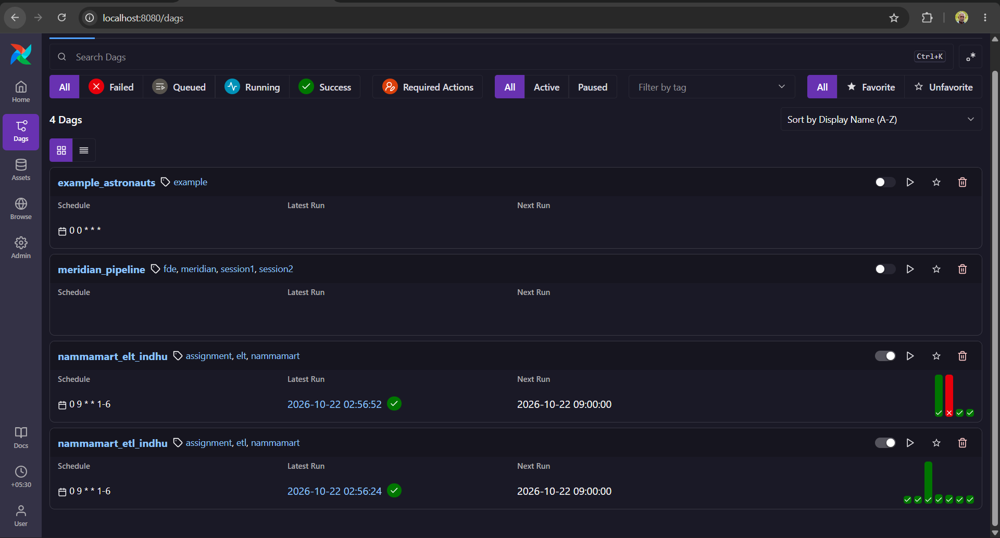
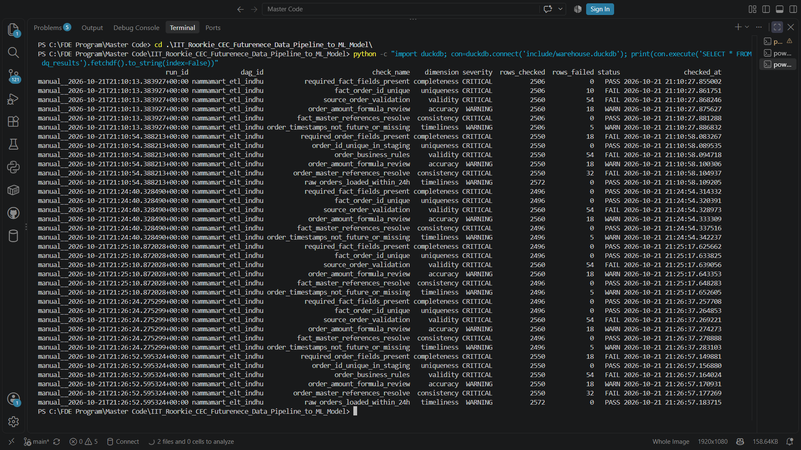
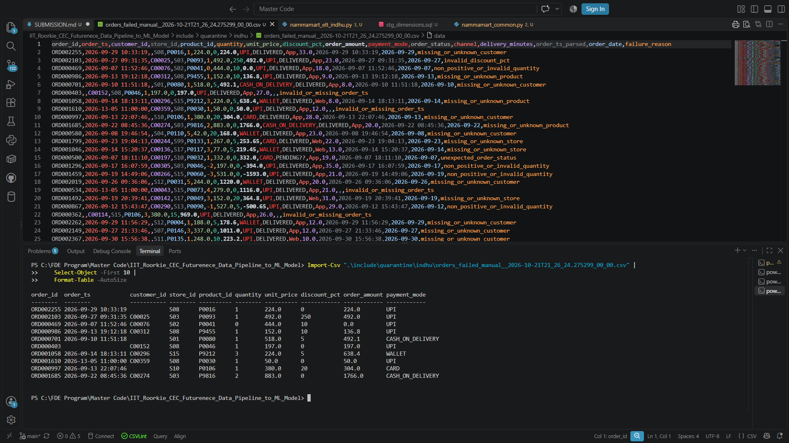
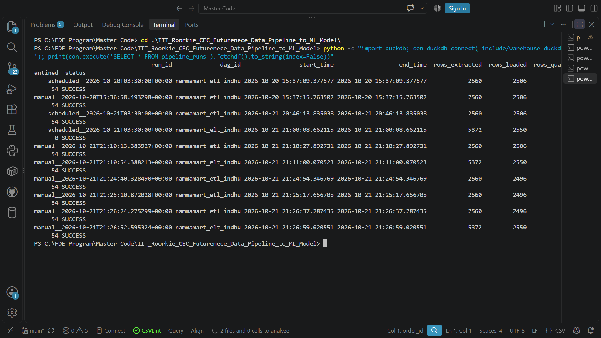

NammaMart Data Pipeline Assignment
Part 0 --- Data Profiling and Quality Assessment
0.1 Source files profiled
The following six CSV files were profiled:
- customers.csv
- orders.csv
- orders_2026-10-01_increment.csv
- payments.csv
- products.csv
- stores.csv
Profiling covered row counts, missing values, duplicate records and
keys, numeric ranges, date ranges, categorical values, referential
integrity, and business-rule validation. The original source files were
not modified during profiling.
0.2 Key data-quality findings
- Customers: Missing email and city values, duplicate customer IDs
  with conflicting contact details, malformed phone numbers, and
  future signup dates.
- Orders: Missing customer IDs, duplicate order rows and order
  IDs, invalid timestamps, non-positive quantities, discounts above
  100%, unexpected statuses and payment modes, and order-amount
  mismatches.
- Incremental orders: 160 rows, including 10 order IDs also
  present in the base file and 150 new order IDs.
- Payments: Duplicate payment IDs, missing gateway references,
  negative amounts marked as successful, and payment references to
  unknown orders.
- Products: Duplicate product IDs, missing categories, a negative
  MRP, and cost prices greater than MRP.
- Stores: One missing zone, one store with zero capacity, and
  order records referencing unknown store IDs.
0.3 Client clarification questions
1. Order amounts and discounts: Should order_amount equal
   quantity multiplied by unit price after discount? Are negative
   quantities and payments valid for returns, refunds, or adjustments?
2. Reporting scope and incremental corrections: Should revenue
   reports include only orders created in September? Should the October
   1 incremental file update existing orders when their status changes,
   and how should future-dated records be handled?
3. Master data and reconciliation: Who owns corrections for missing
   customer, product, and store references, missing categories or
   zones, and missing payment gateway references? Should unresolved
   records be quarantined or handled using approved fallback mappings?
0.4 Proposed assumptions pending confirmation
- Discounts must be between 0% and 100%, and order quantities must be
  positive unless documented return or adjustment rules apply.
- The incremental pipeline should upsert by order_id, updating
  existing records and inserting new ones.
- Exact duplicate records are deduplicated in the cleaned layer while
  raw ELT data remains unchanged.
- Critical validation failures are quarantined rather than silently
  corrected.
- Warnings are logged for review.
- Unconfirmed pricing, date, and refund rules are documented as
  assumptions, not definitive business requirements.
0.5 Referential-integrity summary
- Orders to customers: 18 missing customer references.
- Orders to products: 9 orphan product references.
- Orders to stores: 5 orphan store references.
- Payments to orders: 8 orphan order references.
- The incremental orders file passed the customer, product, and store
  reference checks during profiling.
0.6 Business-rule validation summary
- 10 orders have non-positive quantities.
- 3 orders have discounts outside the 0--100% range.
- 18 orders have amount-calculation mismatches under the proposed
  formula.
- 3 orders have unexpected statuses.
- 3 orders have unrecognized payment modes.
- 8 delivered orders have missing delivery times.
- 6 delivered orders have delivery times above the 120-minute review
  threshold.
- 6 orders have missing or invalid timestamps.
- 7 orders have timestamps after October 1, 2026, requiring scope
  review.
- 6 payments have negative amounts despite a SUCCESS status.
These findings informed the validation, quarantine, reconciliation, and
monitoring rules in the ETL and ELT pipelines.
Part A --- ETL Pipeline
A.1 Implementation overview
The ETL DAG is nammamart_etl_indhu. It reads the source CSVs, combines
the base and incremental order files, normalizes values, validates
orders, quarantines critical failures, transforms accepted records, and
writes analytical outputs to DuckDB.

The main stages are:
1. Extract: Read customers, base orders, incremental orders,
   payments, products, and stores.
2. Normalize and validate: Normalize whitespace and casing in the
   cleaned layer, convert numeric and timestamp fields, and validate
   required IDs, master-data references, quantities, discounts, and
   order statuses.
3. Quarantine and warnings: Write invalid orders to timestamped
   quarantine CSVs with failure reasons. Write order-amount mismatches
   to warning output for review.
4. Transform: Join accepted orders to product and store
   information; derive order_date, net_revenue, gross_margin, and
   within_15_min.
5. Load: Create customer, product, and store dimensions, the order
   fact table, payment reconciliation output, daily store/zone revenue,
   and category-margin output.
A.2 Transformation and business rules
- Exact duplicate order records are removed before validation.
- Critical validation failures are separated from accepted records and
  written to quarantine.
- Customer email and phone fields are masked in the analytical
  customer dimension.
- Product records marked (old) are deprioritized when choosing a
  dimension survivor.
- The load stage applies an implementation rule that gives RETURNED
  precedence over DELIVERED for conflicting versions of the same
  order ID. This is an assumption pending business-owner confirmation.
- Net revenue is calculated for delivered orders after discount:
  quantity × unit_price × (1 − discount_pct / 100).
- Gross margin is calculated as net revenue minus quantity multiplied
  by product cost price for delivered orders.
- The within_15_min indicator is true for delivered orders with
  delivery time at or below 15 minutes.
- Payment reconciliation compares expected order revenue with summed
  payment amounts and labels records as matched when the absolute
  difference is no more than 0.02.
A.3 ETL outputs
The implementation produces the following analytical outputs in DuckDB:
- etl_fact_orders
- etl_dim_customer
- etl_dim_product
- etl_dim_store
- etl_payment_reconciliation
- etl_daily_zone_revenue
- etl_category_margin
The verified fact table contains 2,496 rows and 2,496 distinct order
IDs.
Part B --- ELT Pipeline
B.1 Implementation overview
The ELT DAG is nammamart_elt_indhu. It loads source data into raw
tables, retains source-level records and metadata, and performs
standardization, validation, staging, and mart creation using SQL
transformations.

The main stages are:
1. Raw load: Load source rows into raw tables while retaining
   source values and load metadata such as _loaded_at,
   _source_file, and _run_id.
2. SQL staging: Standardize and cast fields in SQL, identify
   invalid records, and store data-quality status and failure reasons.
3. Quality recording: Write check outcomes to dq_results.
4. Marts: Build daily store KPIs, category margin, delivery SLA,
   payment reconciliation, and top-customer outputs.
B.2 ELT outputs
The implementation creates the following marts:
- mart_daily_store_kpis
- mart_category_margin
- mart_delivery_sla
- mart_payment_reconciliation
- mart_top_customers
The latest verified ELT output contains 2,572 raw order rows and 2,550
staging rows with distinct order IDs. Staging contains 2,496 rows marked
PASS and 54 marked FAIL; failed rows remain available for
investigation rather than being silently removed from the staging layer.
B.3 ETL and ELT design trade-off
ETL applies Python validation and transformation before loading
analytical tables, with explicit quarantine and warning files. ELT
retains raw source records and applies SQL transformations to staging
and marts. Maintaining both approaches is useful for comparing the
designs, but shared business rules and stage definitions should be
standardized before production use to avoid divergent results.
Part C --- Scheduling and Orchestration
C.1 Schedule configuration
Both nammamart_etl_indhu and nammamart_elt_indhu are configured
with:
- Cron expression: 0 9 * * 1-6
- Timezone: Asia/Kolkata (IST, UTC+05:30)
- Schedule: 9:00 AM every Monday through Saturday
- Catchup: Disabled
- Retries: 2
- Retry delay: 2 minutes
- Execution timeout: 20 minutes
The cron expression means minute 0, hour 9, every day of the month,
every month, Monday through Saturday.
C.2 Logical date and data interval
Airflow's logical date identifies the scheduled run period; it is not
necessarily the actual time when a task starts. The data interval
represents the period associated with a scheduled DAG run.

A manually triggered DAG run may have a different logical date or data
interval from a scheduled run. The pipelines currently read the
available source CSV files directly rather than selecting source records
using the logical date.

The configured schedule and successful DAG execution have been observed
in Airflow. IST does not observe daylight-saving time.
C.3 Operational considerations
A scheduled run requires the Airflow environment to be running. If the
local machine or Docker environment is stopped, scheduled runs cannot
execute during that downtime. Missed runs are not automatically
backfilled because catchup is disabled.

For production deployment, the pipelines should run on a continuously
available orchestration environment with monitored task failures,
controlled retries, and documented recovery procedures.
Part D --- Data Quality Framework
D.1 Quality dimensions
The pipelines record data-quality results in the DuckDB table
dq_results. Each result records run ID, DAG ID, check name, quality
dimension, severity, rows checked, rows failed, status, and check
timestamp.
  Dimension                           Purpose
  Completeness                        Check required order fields are
                                      present

  Uniqueness                          Detect duplicate order IDs

  Validity                            Check business rules such as
                                      quantity, discount, references, and
                                      order status

  Accuracy                            Identify order-amount formula
                                      mismatches for review

  Consistency                         Check references between orders and
                                      customer, product, and store master
                                      data

  Timeliness                          Check timestamp validity or
                                  raw-data freshness
A DAG can complete successfully while quality checks report invalid or
questionable records. Pipeline execution status and data-quality status
are separate signals.
D.2 Latest recorded ETL results
  Check                           Rows checked   Rows failed Status
  Required fact fields                   2,496             0 PASS
  Unique fact order IDs                  2,496             0 PASS
  Source order validation                2,560            54 FAIL
  Order-amount formula review            2,560            18 WARN
  Fact-to-master references              2,496             0 PASS
  Timestamp timeliness                   2,496             5 WARN
D.3 Latest recorded ELT results
  Check                           Rows checked   Rows failed Status
  Required order fields                  2,550            18 FAIL
  Unique staging order IDs               2,550             0 PASS
  Order business rules                   2,550            54 FAIL
  Order-amount formula review            2,550            18 WARN
  Order master references                2,550            32 FAIL
  Raw order freshness                    2,572             0 PASS

The ELT quality results show that staging uniqueness can pass while
completeness, validity, or reference checks fail. This is expected when
invalid source records are retained for audit.
D.4 Rejected-row audit and quarantine evidence
The ETL pipeline writes invalid order records to timestamped quarantine
CSV files under include/quarantine/indhu/. Each file includes a
failure reason.

For a representative run, 54 order rows were quarantined:

  Failure reason                          Count
  Missing or unknown customer                18
  Non-positive or invalid quantity           10
  Missing or unknown product                  9
  Invalid or missing order timestamp          6
  Missing or unknown store                    5
  Invalid discount percentage                 3
  Unexpected order status                     3
  Total                              54

Repeated manual and scheduled runs produced separate timestamped files
with the same reason counts. These files are evidence from repeated
executions; their row counts must not be summed and described as unique
rejected source records.

The rejected-row-by-file/reason result is currently produced by
aggregating quarantine CSV files rather than querying a dedicated
rejected-row audit table. A future improvement is to persist each
rejected record's run ID, source file, order ID where available, failure
reason, and rejection timestamp in a queryable table.
D.5 Verified row-count reconciliation
The base orders file contains 2,412 rows and 2,400 distinct order IDs.
The incremental file contains 160 rows and 160 distinct order IDs.
Combined, they contain 2,572 rows and 2,550 distinct order IDs.

The ETL validation stage removes 12 exact duplicate rows, leaving 2,560
rows. Validation separates these into 2,506 passed rows and 54 failed
rows. The load stage then resolves 10 conflicting duplicate order IDs,
each with DELIVERED and RETURNED versions. The
RETURNED-over-DELIVERED rule retains one row for each ID, resulting
in 2,496 unique fact rows.

  Stage                                                  Rows
  Combined source files                                 2,572
  After exact-duplicate removal                         2,560
  Passed validation                                     2,506
  Failed validation / quarantined                          54
  Passed rows after load-stage duplicate resolution     2,496
  ETL fact rows                                         2,496
  ELT raw order rows                                    2,572
  ELT staging rows                                      2,550
  ELT staging PASS                                      2,496
  ELT staging FAIL                                         54

The ETL run metadata's rows_extracted field is calculated from
validation passed plus failed counts. Therefore, its value of 2,560
represents the rows reaching validation accounting after exact-duplicate
removal, not the total 2,572 rows in the original source CSVs. The ELT
rows_extracted value aggregates extraction across multiple source
files and should not be directly compared with order-only row counts.

The RETURNED-over-DELIVERED rule is an implementation assumption and
must be confirmed with the business owner before production use. Other
status conflicts currently receive the default priority, so a broader,
explicit conflict-resolution policy should be agreed.
Part E --- Data Governance
E.1 Ownership and accountability
The following ownership model is proposed for NammaMart. Named business
owners should be confirmed by the client.

  Data domain                                Proposed responsibility
  Orders and order status                    Order operations / business owner
  Customers and personal information         Customer data owner
  Products, prices and categories            Product catalogue owner
  Stores, zones and capacity                 Store operations owner
  Payments and gateway references            Finance / payment operations owner
  Pipeline execution and technical quality   Data engineering team

Business owners are responsible for confirming business rules and
resolving master-data issues. Data engineering is responsible for
implementing approved rules, recording quality results, maintaining
lineage, and monitoring pipeline execution.
E.2 Data dictionary
The primary analytical entities are:
- Orders: Order ID, order timestamp/date, customer ID, product ID,
  store ID, quantity, unit price, discount, order amount, payment
  mode, order status, channel, and delivery time.
- Customers: Customer ID, name, email, phone, city, signup date,
  and loyalty tier.
- Products: Product ID, product name, category, unit price and
  cost price, subject to the actual source schema.
- Stores: Store ID, store name, zone, area, and capacity, subject
  to the actual source schema.
- Payments: Payment ID, order reference, payment mode/status,
  amount, and gateway reference, subject to the actual source schema.
- ETL fact: Order-level analytical measures including net revenue,
  gross margin, and delivery-within-15-minutes.
- ELT staging: Standardized order records with data-quality
  status, failure reason, and source metadata.
Source CSV headers remain the authoritative column definitions. Detailed
types, nullability, keys, and business definitions should be maintained
alongside pipeline SQL and source profiles.
E.3 Lineage and auditability
The ELT raw tables retain source columns and add _loaded_at,
_source_file, and _run_id metadata. This supports tracing records to
their source file and load execution.

The dq_results table stores quality-check outcomes. The
pipeline_runs table stores run IDs, DAG IDs, start and end timestamps,
extracted and loaded row counts, quarantined-row counts, and run status.

The ETL pipeline writes failed orders to quarantine files with a
failure_reason. Warning files separately record order-amount
mismatches for review.
E.4 Privacy and personal information
Customer email addresses and phone numbers are personal information. The
ETL customer dimension applies masking to these fields. Access to raw
customer data should be restricted to authorized roles with a legitimate
operational need.

For production deployment, privacy controls should be reviewed against
applicable Indian law, including the Digital Personal Data Protection
Act, 2023, and applicable rules and commencement provisions. The
organization should confirm its legal obligations and approved retention
policy rather than assume a specific retention period applies
universally.
E.5 Access, secrets, and retention
- Grant access according to least privilege and role-based
  responsibilities.
- Avoid committing passwords, access tokens, connection strings, or
  webhook secrets to source control.
- Store production credentials in an approved secrets manager or
  managed connection mechanism.
- Restrict access to raw data, quarantined records, audit tables, and
  unmasked customer information.
- Define and approve retention periods for raw data, quarantine files,
  logs, and personal information.
- Audit access to sensitive datasets and document who can approve
  corrections to master data and order status.
These controls are proposed governance requirements; production
access-control enforcement and retention configuration require separate
verification.
E.6 Corrections and change history
When an order changes from one status to another, the pipeline should
retain sufficient source and run metadata to explain which source record
was selected. The incremental file contains 10 order IDs that overlap
the base file and 150 new IDs.

The current transformation gives RETURNED precedence over DELIVERED
for the identified conflicting order IDs. This is an implementation
assumption that should be confirmed with the business owner. A
production implementation should preserve a traceable history of
corrections rather than silently losing previous versions.
Part F --- Experiments and Observability
F.1 Test recording method
Each experiment records the expected behavior, observed result and
evidence, where it was checked, and the corrective action or follow-up.
An experiment is marked completed only after it has been executed and
its outcome recorded. Tests that have not been run are marked pending.
F.2 Experiment log
Experiment 1 --- Happy path
- Expected: Both DAGs complete and create the expected analytical
  outputs.
- Observed: ETL and ELT completed successfully. ETL created its
  fact, dimension, and reporting outputs. ELT populated raw orders,
  staging orders, and five reporting marts.
- Where: Airflow DAG run history and include/warehouse.duckdb.
- Change: No pipeline execution fix was required for the verified
  runs. Output reconciliation is documented in Part D.
Experiment 2 --- Rerun and idempotency
- Expected: Rerunning the same inputs should not duplicate records
  or inflate reporting metrics.
- Observed: Multiple successful runs were recorded. The ETL fact
  table was verified to contain no duplicate order IDs. A formal
  before/after comparison of every output table has not been
  completed.
- Where: etl_fact_orders, stg_orders, pipeline_runs, and
  dq_results.
- Change: Complete a table-by-table count and metric comparison
  after a rerun before claiming full idempotency.
Experiment 3 --- Incremental processing
- Expected: The 160-row increment should update existing orders
  and insert new orders without duplicate order IDs.
- Observed: The increment contains 10 IDs that overlap the base
  file and 150 new IDs. ELT raw orders contain 2,572 rows and staging
  contains 2,550 rows. The ETL load-stage conflict rule is documented
  in Part D.
- Where: orders.csv, orders_2026-10-01_increment.csv,
  raw_orders, stg_orders, and etl_fact_orders.
- Change: Confirm the status-selection rule with the business
  owner and verify incremental correction behavior in a controlled
  test.
Experiment 4 --- Missing source file
- Expected: The DAG should fail clearly when a required source
  file is unavailable, and the failure should be visible in Airflow.
- Observed: Not yet executed.
- Where: Source extraction task logs and Airflow task status.
- Change: Temporarily move a test source file, trigger the
  relevant DAG, capture the failure, and restore the file immediately
  after the test.
Experiment 5 --- Injected invalid records
- Expected: Five test records representing a missing customer,
  negative quantity, unknown store, unexpected SHIPPED status, and
  future timestamp should be identified by applicable quality rules.
- Observed: Not yet executed as a controlled injection test. The
  existing dataset already contains missing references, invalid
  quantities, unexpected statuses, and invalid/future timestamps.
- Where: Validation task logs, quarantine output, staging
  dq_status/failure_reason, and dq_results.
- Change: Run the five controlled cases in a temporary test copy,
  verify each outcome, and restore the original data.
Experiment 6 --- Schema change
- Expected: Renaming order_amount to total should produce a
  clear schema/SQL failure or a documented compatibility response,
  rather than silently corrupting results.
- Observed: Not yet executed.
- Where: Raw loading task, SQL transformation logs, and schema
  inspection.
- Change: Test using a temporary copy of the source file, record
  the outcome, and restore the original file.
Experiment 7 --- Low-volume input
- Expected: A test dataset containing only 50 orders should
  process successfully, with output counts and quality checks
  reflecting the smaller volume.
- Observed: Not yet executed.
- Where: ETL fact table, ELT staging table, marts, and
  dq_results.
- Change: Run against an isolated test copy and restore the full
  dataset after recording the result.
Experiment 8 --- Price anomaly and drift
- Expected: Multiplying prices by 100 for one store should create
  a detectable anomaly in revenue or price-related metrics.
- Observed: Not yet executed as a controlled experiment.
- Where: Store-level revenue metrics, category-margin metrics, and
  comparison with the baseline.
- Change: Use a temporary test copy, calculate baseline versus
  modified metrics, and document an appropriate alert threshold. Do
  not modify the original source data.
Experiment 9 --- Stale data / freshness
- Expected: Data older than the defined freshness threshold should
  be flagged as stale.
- Observed: The current ELT timeliness check passed for 2,572 raw
  order rows. A 30-day-old data injection has not been executed.
- Where: dq_results, raw load metadata, and freshness-check
  logs.
- Change: Test with controlled stale metadata or a test copy and
  verify that the freshness check detects it.
Experiment 10 --- Recovery
- Expected: Clearing and rerunning a failed task should recover
  the pipeline without duplicate records or inconsistent results.
- Observed: Not yet executed as a controlled recovery experiment.
- Where: Airflow task history, pipeline_runs, etl_fact_orders,
  stg_orders, and relevant marts.
- Change: Induce a controlled failure, clear the failed task, and
  verify the rerun and final counts.
F.3 Observability mapping
  Observability pillar                Evidence or implementation
  Logs                                Airflow task logs, validation
                                      output, quarantine and warning
                                      files

  Metrics                             Extracted, loaded, and quarantined
                                      counts; quality rows checked and
                                      failed

  Traces / execution lineage          DAG task history, run IDs,
                                      source-file metadata, and task
                                      dependencies

  Alerts                              Airflow task failures and quality
                                      results requiring operational
                                      review; alert delivery needs
                                      verification

  Dashboards                          DuckDB reporting marts; a
                                      production monitoring dashboard
                                  remains a follow-up item
The pipeline run and quality tables provide an audit foundation. Full
alert delivery, dashboarding, and the controlled experiments above must
be verified before they are described as completed.
Part G --- Recommendation to the CTO
To: Sameer, CTO
Subject: Recommendation for NammaMart's ETL and ELT pipeline
approach
Executive recommendation
Proceed with the current ETL and ELT implementations as a validated
prototype, but do not treat them as production-ready until the remaining
reconciliation, recovery, and observability tests are completed.
Evidence and trade-offs
Data quality and auditability: Both DAGs have executed successfully.
The ETL fact table contains 2,496 rows with no duplicate order IDs. The
ELT staging table contains 2,550 rows, including 54 records marked as
failed. Quality results cover completeness, uniqueness, validity,
accuracy, consistency, and timeliness. These results show that the
pipeline can surface data-quality problems instead of silently treating
all source records as clean.

Ease of change: ELT retains source data in raw tables and uses SQL
staging and marts. This makes transformation logic easier to inspect and
revise. ETL applies Python-based transformation before loading
analytical tables and provides explicit quarantine and warning outputs.
Maintaining both approaches is useful for the assignment comparison, but
production should standardize shared business rules to avoid divergent
results.

Scale and cost: The current CSV and DuckDB implementation is
suitable for demonstrating the workflow and validating business rules.
Performance at 1,000 times the current volume has not been tested. A
production scale assessment should benchmark throughput, memory,
runtime, storage, concurrency, and operational cost using a
representative cloud platform and workload.
Top three risks and mitigations
1. Inconsistent business rules: ETL and ELT have different
   processing paths and quality-check outcomes. Define shared
   validation rules, confirm return/correction semantics, and reconcile
   the outputs before production approval.
2. Operational recovery and monitoring: Successful DAG runs do not
   prove recovery, alert delivery, or full idempotency. Complete
   controlled failure/recovery tests, verify retries, and implement
   actionable alerts and run-level monitoring.
3. Privacy and governance gaps: Customer data, quarantine files,
   and raw records require controlled access, retention policies, and
   auditable handling. Assign data owners, enforce least privilege,
   review applicable privacy obligations, and approve retention and
   correction procedures.
Decision requested
Approve continued development and controlled testing of the prototype.
Production rollout should be conditional on reconciled ETL/ELT outputs,
completed critical experiments, verified recovery behavior, and approved
governance controls.
Business Questions --- Query Results
The following results were obtained by running the SQL in
include/sql/business_questions.sql against include/warehouse.duckdb.
They reflect the current local dataset and should be interpreted with
the data-quality caveats described above.
1. Daily net revenue by zone and store
The query returns delivered-order net revenue by order date, zone, store
ID, and store name. The output includes records for store S07 with a
missing zone, which is a known master-data issue. The result also
includes some future-dated orders, which require confirmation of
reporting scope.
2. Revenue and gross margin by category
  Category                Net revenue   Gross margin
  Staples                  299,565.05      64,419.48
  Personal Care            217,476.05      47,414.10
  Household                214,647.85      54,911.21
  Dairy & Bakery           181,471.60      48,048.02
  Snacks & Beverages       176,718.45      41,897.99
  Fruits & Vegetables      100,571.40      20,705.90
  Missing category          41,911.75       4,943.39

Staples has the highest net revenue in the query output. Missing
category values remain visible and should be corrected in the product
master rather than silently assigned to a category.
3. Average delivery time and within-15-minute rate by store
- Highest average delivery time: S09 (Indiranagar), approximately
  31.49 minutes.
- Lowest within-15-minute rate: S06 (Banashankari), approximately
  21.29%.
- Highest within-15-minute rate: S08 (Whitefield), approximately
  35.54%.
These metrics are based on the current delivered-order records with
non-null delivery times. They are useful for identifying stores for
further operational review, not proof of root cause.
4. Delivered revenue by payment mode
  Payment mode         Net revenue
  UPI                   650,999.70
  CARD                  254,507.05
  CASH_ON_DELIVERY      186,287.15
  WALLET                139,902.25
  CASHH                     666.00

CASHH appears as an unexpected payment mode in the source data and
should be reviewed rather than treated as an approved payment category.
5. Total absolute unreconciled amount
The query returned 210,031.99 as the sum of absolute unreconciled
amounts. This is the sum of absolute differences, not necessarily the
net financial exposure. The unreconciled records should be investigated
by finance/payment operations.
6. Top 10 customers by spend
The query returns the top 10 customers by delivered-order spend and
displays masked email and phone fields. The customer-level results
should remain restricted to authorized users; the submission should use
masked fields and avoid including raw personal contact information.
Rejected rows by file and reason
Rejected rows are currently summarized from the timestamped ETL
quarantine CSV files under include/quarantine/indhu/. The
representative run contains 54 rejected rows across seven reason
categories. A dedicated queryable rejected-row audit table has not yet
been implemented, so the quarantine files remain the evidence source for
this question.

---

## Appendix — Screenshot References

The following screenshots provide evidence of pipeline execution, scheduling, data quality, quarantine handling, and reconciliation.

### A. Airflow Pipeline Execution

**Figure A1. ETL DAG execution**

**Figure A2. ELT DAG execution**

### B. Scheduling Configuration

**Figure B1. DAG pipeline schedules**

### C. Data Quality and Validation

**Figure C1. Data quality results**

**Figure C2. Quarantined records and failure reasons**

### D. Pipeline Reconciliation

**Figure D1. Pipeline run counts and status**

